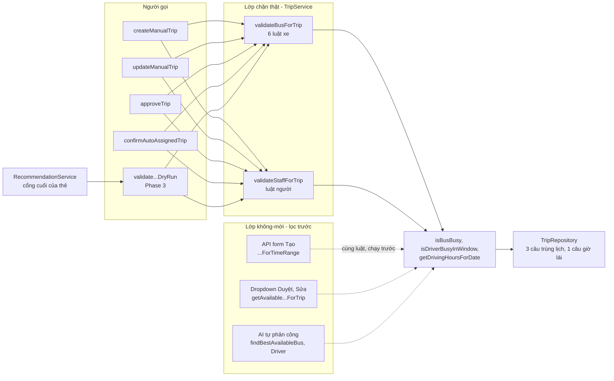
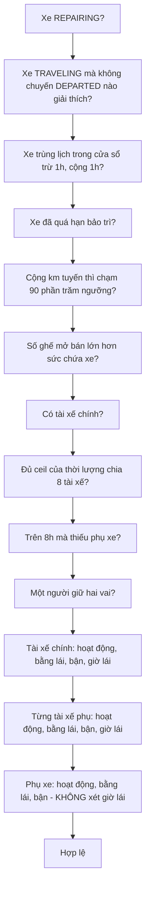
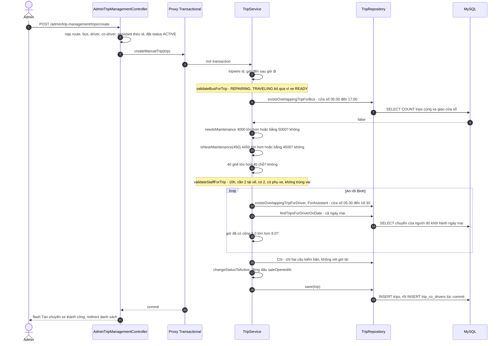
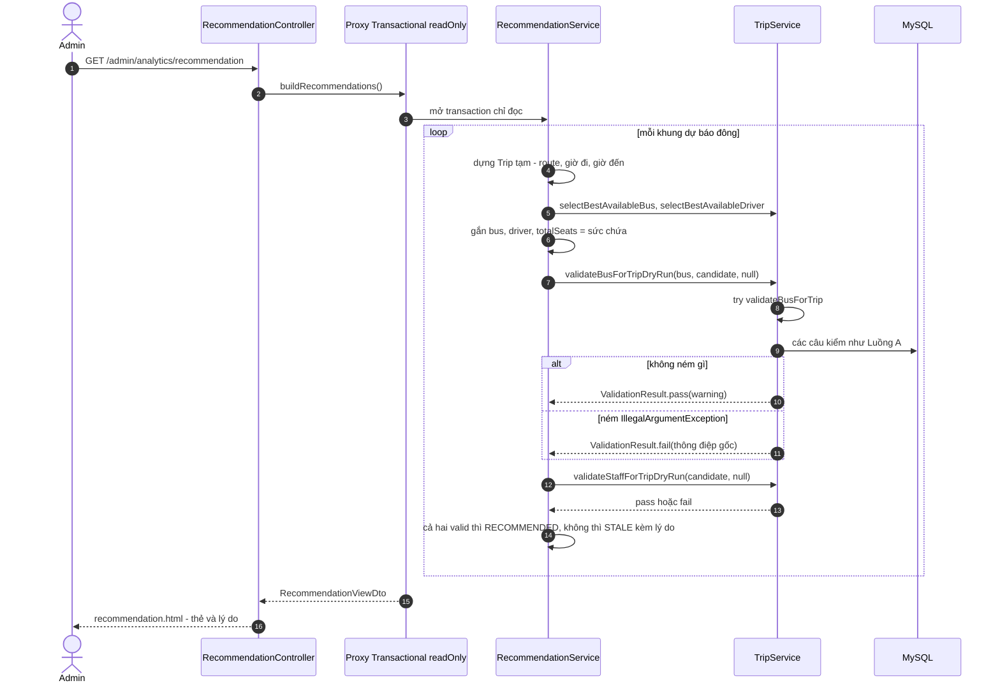

# Bài 06 — Business Rule Validation (Kiểm tra ràng buộc nghiệp vụ: xe, tài xế, phụ xe)

> Bài chức năng thứ sáu, sinh từ `docs/ai/03_defense_study_prompt.md` (PHẦN B), ngày 2026-10-06.
> Học sau Bài 00a, 00b, 01–05. Số dòng là ảnh chụp ngày viết — lệch thì grep lại.
>
> Nhãn: [CODE] đọc thẳng từ code · [SPRING] hành vi chuẩn của Spring/Hibernate mà code không viết
> ra · [SUY LUẬN] suy luận của người viết ("chưa kiểm chứng" nếu chưa chạy thử).
>
> Viết tắt: `…/` = `src/main/java/giang/com/BusManagement/`, `test/` =
> `src/test/java/giang/com/BusManagement/`, `tpl/` = `src/main/resources/templates/`,
> `TS` = `…/service/TripService.java`, `TR` = `…/repository/TripRepository.java`.
>
> **Phạm vi.** Giống Bài 05, chức năng này **không có màn hình riêng**: nó là hai method private
> trong `TripService` — `validateBusForTrip()` (`TS:1106-1211`) và `validateStaffForTrip()`
> (`TS:1226-1367`) — cùng hai "vỏ bọc" public không ném lỗi (`TS:1407-1443`, Phase 3). Năm nơi gọi
> vào chúng thuộc Bài 07 (tạo/sửa), Bài 09 (duyệt) và Bài 17 (Recommendation). Bài này có 🧮: §8
> bắt buộc tính tay.

---

## §1. Chức năng này là gì — nói kiểu đời thường

**Vấn đề thật của nhà xe.** Mỗi lần xếp một chuyến, có những điều **không được sai**: xe đang sửa
thì không chạy được; một xe không thể ở hai chuyến cùng lúc; xe sắp tới hạn bảo dưỡng thì không nên
nhận chuyến đường dài; tài xế đã nghỉ việc hoặc bằng lái hết hạn vào ngày chạy thì không được cầm
lái; một người không được lái quá 8 tiếng một ngày; chuyến dài hơn 8 tiếng phải có đủ người thay ca
và một phụ xe. Bán nhiều vé hơn số ghế thật của xe cũng là sai.

Đây là **ràng buộc nghiệp vụ** (*business rule* — "luật của nghề, không phải của máy"). Chức năng
này gom **mọi** luật đó vào **hai** method và bắt mọi lối lưu chuyến đi qua chúng. Không có nó thì
mỗi màn hình tự kiểm một kiểu, và chỉ cần một màn quên là có chuyến chạy bằng xe đang sửa.

Phase 3 thêm một cách hỏi thứ hai: **dry-run** (*"chạy thử — hỏi xem có hợp lệ không, nhưng không
báo lỗi ầm ĩ"*). Màn Gợi ý tăng cường (Bài 17) cần hỏi "phương án này còn hợp lệ không?" cho hàng
chục ứng viên; với nó, "không hợp lệ" là **kết quả bình thường**, không phải sự cố.

**Một kịch bản cụ thể** (minh hoạ). Chị admin tạo chuyến Hà Nội → Vinh ngày mai, 06:00–16:00 (10
tiếng). Chị chọn xe 29A-001.05, tài xế chính anh An, tài xế phụ anh Bình, phụ xe chị Chi. Bấm Lưu →
*"Lỗi: Tài xế phụ Bình đã được phân công lái 4.0h trong ngày …, thêm chuyến này (5.0h) sẽ vượt
8h/ngày!"*. Chị đổi chuyến tối của anh Bình ngắn đi 1 tiếng, lưu lại → *"Tạo chuyến xe thành công!"*.
Hôm sau chị duyệt một chuyến tăng cường, chọn một xe đã chạy gần đủ km bảo dưỡng → *"⛔ Vi phạm ràng
buộc: Xe … sẽ SẮP/QUÁ ngưỡng bảo trì (5000km) sau chuyến này…"*. Chị chọn xe khác.

---

## §2. Bản đồ tổng quan

### 2.1. Các mảnh ghép

| Loại | File | Trách nhiệm (1 dòng) |
|---|---|---|
| Service — luật xe | `TS:1106-1211` `validateBusForTrip()` | 6 luật xe, ném `IllegalArgumentException` ở luật đầu tiên bị vi phạm; trả `String` cảnh báo (luôn `null`) |
| Service — luật người | `TS:1226-1367` `validateStaffForTrip()` | Số tài xế, phụ xe, trùng vai, rồi từng người: hoạt động / bằng lái / bận / giờ lái |
| Service — dry-run | `TS:1407-1413`, `:1436-1443` | Bọc hai validator trong `try/catch (IllegalArgumentException)`, trả `ValidationResult` |
| Kết quả | `…/service/ValidationResult.java` | Bất biến: `valid`, `failureReason` (tối đa **một**), `warning`; tạo qua `pass()` / `pass(w)` / `fail(r)` |
| Service — hàm phụ | `TS:352-377` `isBusBusy()`; `:701-735` `isDriverBusyInWindow()`; `:740-835` `getDrivingHoursForDate()` + `sumDrivingHours()`; `:397-434` ba predicate | Xe bận? người bận? giờ lái trong ngày? |
| Service — hằng số | `TS:33` `MIN_REST_BETWEEN_TRIPS_MINUTES = 30`; `:39` `BUS_PREP_BUFFER_HOURS = 1` | Đệm 30 phút cho người, 1 giờ cho xe |
| Repository | `TR:131-142`, `:150-160`, `:171-179`, `:186-197`; `:393` | 3 câu "có trùng lịch không", 1 câu "chuyến của tài xế trong ngày", 1 câu "xe có chuyến DEPARTED không" |
| Entity | `…/domain/Bus.java:42-76`; `…/domain/Driver.java:47-61` | `getKmSinceLastMaintenance()`, `needsMaintenance()`, `isNearMaintenance(km)`; `isLicenseValid(LocalDate)` |
| Lớp "không-mời" | `TS:1483-1685` (dropdown), `:308-332` + `:472-523` (AI), `TripRestController.java:47-86` (API form Tạo) | Lọc trước những gì validator sẽ từ chối |
| Người gọi (throw) | `TS:929-930`, `:1007-1008`, `:1051-1052`, `:1076-1077` | `confirmAutoAssignedTrip`, `approveTrip`, `createManualTrip`, `updateManualTrip` |
| Người gọi (dry-run) | `…/service/RecommendationService.java:236-245` | Cổng xác nhận cuối của thẻ gợi ý |
| Test | `test/service/TripServiceValidationDryRunTest.java` (12), `TripServiceSeatCapacityTest` (9), `TripServiceDriverShareTest` (9), `TripServiceAssistantAvailabilityTest` (4), `TripServiceAvailabilityContextTest` (3) | §9.4 |

### 2.2. Bảng endpoint — đủ mọi điểm bắt đầu

Validator không có endpoint riêng. Đây là mọi lối **dẫn tới** nó. `ATM` =
`AdminTripManagementController.java`, `ATC` = `AdminTripController.java`.

| HTTP / trigger | URL | Controller method | Được gọi từ đâu | Service chính | Kết quả |
|---|---|---|---|---|---|
| POST | `/admin/trip-management/trips/create` | `ATM.createTrip()` `:136-193` | nút Lưu ở `trip-create-form.html` (Bài 07) | `createManualTrip()` → cả hai validator, `excludeTripId = null` (`TS:1051-1052`) | thành công: redirect danh sách + `success`; lỗi: redirect `/trips/create` + `error` "Lỗi: …" |
| POST | `/admin/trip-management/trips/update` | `ATM.updateTrip()` `:355-460` | nút Lưu ở `trip-edit-form.html` (Bài 07) | `updateManualTrip()` → cả hai, `excludeTripId = id chuyến` (`TS:1076-1077`) | lỗi: redirect form sửa + "Lỗi: …" |
| POST | `/admin/trips/approve` | `ATC.processManualApproval()` `:166-201` | MANUAL MODE ở `approve-form.html` (Bài 09) | `approveTrip()` → cả hai, `excludeTripId = tripId` (`TS:1007-1008`) | lỗi: `catch (IllegalArgumentException)` → "⛔ Vi phạm ràng buộc: …" → `/admin/trips/approve/{id}` |
| POST | `/admin/trips/confirm` | `ATC.confirmAutoAssigned()` `:135-156` | nút Xác nhận AUTO MODE (Bài 09) | `confirmAutoAssignedTrip()` → cả hai (`TS:929-930`) | lỗi validator: `catch (Exception)` → "Lỗi xác nhận: …" → `/admin/trips/approve/{id}` |
| GET | `/admin/analytics/recommendation` | `RecommendationController` `:35-38` | menu Analytics (Bài 17) | `buildRecommendations()` → `buildCard()` → **hai bản dry-run** (`RecommendationService.java:236-237`) | thẻ `RECOMMENDED` hoặc `STALE` kèm lý do (`recommendation.html:171`, `:204`) |
| GET (`fetch`) | `/api/admin/trips/available-resources` | `TripRestController.getAvailableResources()` `:47-86` | JS form Tạo (`trip-create-form.html:482-484`) | 3 bộ lọc `…ForTimeRange` — **lớp không-mời**, không gọi validator | JSON `buses`, `drivers`, `assistants` |
| `@Scheduled` | — | `TS.scanAndSuggestExtraTrips()` `:76-78` | job 10 giây (Bài 08) | AI chọn bằng `findBestAvailableBus/Driver` — **không** gọi validator; validator chạy lại lúc Admin xác nhận | chuyến `PENDING_APPROVAL` |

### 2.3. Sơ đồ toàn cảnh



Thứ tự kiểm (**fail-fast** — *"gặp lỗi đầu tiên là dừng, không kiểm tiếp"*):



Mỗi ô là một chỗ có thể ném `IllegalArgumentException`. Mọi người gọi đều chạy **xe trước, người
sau** (`TS:929-930`, `:1007-1008`, `:1051-1052`, `:1076-1077`).

### 2.4. Điều cốt lõi cần nhớ

1. **Một nơi giữ luật, nhiều nơi hỏi.** Bốn lối lưu chuyến cùng gọi hai validator; màn Gợi ý gọi
   qua bản dry-run — bản này **không chép** luật, chỉ bắt exception (`TS:1407-1413`). Đổi luật ở
   validator thì mọi lối đổi theo.
2. **Ném `IllegalArgumentException` ở luật đầu tiên bị vi phạm.** Nên mỗi lần chỉ báo **một** lý do,
   kể cả bản dry-run (chủ dự án duyệt, roadmap §9).
3. **Hai cửa sổ thời gian**: xe bận khi có chuyến giao khoảng `[khởi hành − 1h, đến + 1h]`; người
   bận khi giao `[khởi hành − 30', đến + 30']`. "Giao" là **giao thật** — chạm đúng mép không tính.
4. **Luật 8 giờ tính theo phần chia**: chuyến dài chia đều cho số người lái, mỗi phần tối đa 8h;
   cộng với giờ của các chuyến **khởi hành cùng ngày lịch**; phụ xe tính 0h. Giờ nền mock
   `totalDrivingHours24h` chỉ cộng khi ngày đó là **hôm nay**.
5. **Hai lớp bảo vệ.** Dropdown, API form Tạo và AI lọc trước (lớp không-mời) — nguyên tắc "một
   chiều": lớp mời **không được rộng hơn** validator. Validator là lớp chặn thật duy nhất.

---

## §3. Trace chi tiết các luồng chính

**Chọn luồng nào và vì sao.**

- **Luồng A — Tạo chuyến 10 tiếng có tài xế phụ và phụ xe, đi qua đủ mọi luật và qua ở biên 8h.**
  Đây là đường throw đầy đủ nhất: đi qua cả 6 luật xe, mọi luật người, với **4 loại truy vấn** khác
  nhau, và dừng đúng ở biên `8.0 ≤ 8.0` của luật giờ lái.
- **Luồng B — Cổng dry-run của màn Gợi ý tăng cường.** Đây là sản phẩm của Phase 3: cùng validator
  nhưng hỏi bằng dữ liệu thay vì exception. Cho thấy vì sao chỉ bắt `IllegalArgumentException`.

### 3.1. Luồng A — Tạo chuyến 10 tiếng

**Số liệu minh hoạ.** Ngày mai, 06:00 → 16:00 (10h), tuyến 450 km. Xe #5 `READY`, loại 40 chỗ,
`odometer = 9000`, `lastMaintenanceOdometer = 5000` (⇒ đã chạy 4000 km kể từ lần bảo dưỡng), ngưỡng
5000 km; `totalSeats = 40`. Tài xế chính An: ngày mai chưa có chuyến. Tài xế phụ Bình: ngày mai có
chuyến 18:00–21:00 một mình lái. Phụ xe Chi: rảnh. Cả ba đang hoạt động, bằng lái còn hạn.

**(a) Sơ đồ**



**(b) Bảng từng bước**

| # | Tầng | Vị trí | Method / thành phần | Nhận vào | Làm gì | Trả về / gọi tiếp | Nhãn |
|---|---|---|---|---|---|---|---|
| 1 | Controller | `ATM:136-174` | `createTrip()` | `@ModelAttribute Trip` + `routeId`, `busId`, `driverId`, `assistantId`, `coDriverIds` | nạp từng entity bằng `findById` của **repository** (controller inject thẳng repository — anti-pattern đã biết, roadmap §3); gắn vào `trip`; `coDrivers = [Bình]` | `trip` chưa có id | [CODE] |
| 2 | Controller | `ATM:177-181` | đặt trạng thái + gọi service | — | `setStatus(ACTIVE)`, `setExtraTrip(false)`, rồi `tripService.createManualTrip(trip)` trong `try` | → proxy | [CODE] |
| 3 | Proxy | `TS:1038` | `@Transactional` | — | mở transaction | — | [SPRING] |
| 4 | Service | `TS:1040-1048` | tripwire + giờ | — | `id != null` ⇒ ném (lỗi #21); giờ đến **khác null** mà trước giờ đi ⇒ ném. Giờ đến `null` thì **không** bị chặn ở đây (lỗi #28, §9.3) | — | [CODE] |
| 5 | Service | `TS:1051` → `:1106-1110` | `validateBusForTrip(bus, trip, null)` — luật 1 | `status = READY` | không phải `REPAIRING` | — | [CODE] |
| 6 | Service | `TS:1146-1155` | luật 2 — cờ `TRAVELING` | `READY` | không phải `TRAVELING` ⇒ **bỏ qua cả nhánh**, không truy vấn | — | [CODE] |
| 7 | Service | `TS:1157-1163` | cửa sổ xe | 06:00, 16:00 | giờ đến `null` thì lấy `departure + 5h`; `windowStart = 05:00`, `windowEnd = 17:00` (`BUS_PREP_BUFFER_HOURS = 1`, `TS:39`) | — | [CODE] |
| 8 | Service → DB | `TS:1165` → `:352-371` → `TR:171-179` | luật 3 — `isBusBusy` → `existsOverlappingTripForBus` | xe #5, trạng thái bận `ACTIVE, DEPARTED, PENDING_APPROVAL` | [SUY LUẬN — SQL tương đương] `SELECT COUNT(t.id) > 0 FROM trips t WHERE t.bus_id = 5 AND t.status IN ('ACTIVE','DEPARTED','PENDING_APPROVAL') AND t.departure_time < '…17:00' AND t.arrival_time_expected > '…05:00' AND t.is_deleted = false` (vế `excludeTripId` luôn đúng vì tham số `null`) | `false` | [CODE]+[SPRING] |
| 9 | Service | `TS:1173-1178` → `Bus.java:48-52` | luật 4 — `needsMaintenance()` | kmSince = 9000 − 5000 = 4000 | 4000 ≥ 5000? Không | — | [CODE] |
| 10 | Service | `TS:1186-1194` → `Bus.java:72-76` | luật 5 — `isNearMaintenance(450)` | — | 4000 + 450 = 4450 ≥ 5000 × 0,9 = 4500? Không | — | [CODE] |
| 11 | Service | `TS:1203-1208` → `:1219-1221` | luật 6 — sức chứa | `capacity = 40` | 40 > 40? Không (lỗi #22). Xe chưa gán loại ⇒ `capacity = null` ⇒ bỏ qua | `return null` | [CODE] |
| 12 | Service | `TS:1052` → `:1227-1235` | `validateStaffForTrip(trip, null)` | — | `durationHours = 600 phút / 60 = 10.0`; `requiredDrivers = ceil(10/8) = 2` | — | [CODE] |
| 13 | Service | `TS:1238-1253` | có tài xế chính? đủ người? | — | `driver != null`; `assigned = 1 + coDrivers.size() = 2` ≥ 2 | — | [CODE] |
| 14 | Service | `TS:1256-1259` | phụ xe cho chuyến dài | — | `10.0 > 8.0` và có Chi ⇒ qua | — | [CODE] |
| 15 | Service | `TS:1262-1292` | trùng vai | — | `HashSet` id: An; Bình khác An và chưa có ⇒ thêm; Chi khác An và chưa có ⇒ thêm. Chỉ ghi vào biến cục bộ | — | [CODE] |
| 16 | Service | `TS:1296-1299` | cửa sổ người + phần chia | — | `windowStart = 05:30`, `windowEnd = 16:30` (`TS:33`); `shareDuration = 10/2 = 5.0`; `effectiveHours = min(5.0, 8.0) = 5.0` | — | [CODE] |
| 17 | Service | `TS:1302-1310` → `Driver.java:47-49` | An: hoạt động, bằng lái | — | `Boolean.TRUE.equals(isActive)`; `isLicenseValid(ngày mai)` = hạn bằng **sau hẳn** ngày khởi hành (Bài 04 §8.1) | — | [CODE] |
| 18 | Service → DB | `TS:1311` → `:714-728` → `TR:131-142`, `:150-160` | An bận? | trạng thái bận `PENDING_APPROVAL, ACTIVE, DEPARTED` | hai câu: [SUY LUẬN — SQL tương đương] `SELECT COUNT(t.id) > 0 FROM trips t LEFT JOIN trip_co_drivers cd ON cd.trip_id = t.id WHERE (t.driver_id = An OR cd.user_id = An) AND t.status IN (…) AND t.departure_time < '…16:30' AND t.arrival_time_expected > '…05:30' AND t.is_deleted = false`, rồi câu tương tự với `t.assistant_id = An` | `false`, `false` | [CODE]+[SPRING] |
| 19 | Service → DB | `TS:1315` → `:752-772` → `TR:186-197` | giờ lái của An ngày mai | thêm `COMPLETED` vào tập trạng thái (`TS:756-757`) | [SUY LUẬN — SQL tương đương] `SELECT DISTINCT t.*, cd.* FROM trips t LEFT JOIN trip_co_drivers cd … WHERE (t.driver_id = An OR cd.user_id = An OR t.assistant_id = An) AND t.status IN (4 trạng thái) AND t.departure_time >= 'mai 00:00' AND t.departure_time < 'mốt 00:00' AND t.is_deleted = false` | danh sách rỗng | [CODE]+[SPRING] |
| 20 | Service | `TS:782-834` `sumDrivingHours()` | — | rỗng | tổng 0; ngày mai ≠ hôm nay ⇒ **không** cộng giờ nền mock | `0.0` | [CODE] |
| 21 | Service | `TS:1316` | luật 8h của An | 0.0 + 5.0 | `> 8.0`? Không | — | [CODE] |
| 22 | Service | `TS:1324-1346` | Bình: như bước 17–21 | — | bận? chuyến 18:00–21:00: `18:00 < 16:30`? **Không** ⇒ không giao ⇒ không bận. Giờ lái: chuyến đó khởi hành ngày mai, Bình lái một mình ⇒ `min(3/1, 8) = 3.0` | 3.0 + 5.0 = **8.0** `> 8.0`? **Không** ⇒ qua đúng ở biên | [CODE] |
| 23 | Service | `TS:1349-1366` | Chi (phụ xe) | — | hoạt động, bằng lái, hai câu kiểm bận; **không** có luật giờ lái | — | [CODE] |
| 24 | Service | `TS:1054` → `:1929-1934` | `changeStatusToActive()` | — | `ACTIVE` + `saleOpenedAt = now()` (Bài 05) | — | [CODE] |
| 25 | Service → DB | `TS:1055` | `tripRepository.save(trip)` | `id = null` | `persist`; `IDENTITY` ⇒ `INSERT INTO trips …` chạy **ngay**; dòng `trip_co_drivers (trip_id, user_id = Bình)` ghi khi flush/commit | — | [SPRING] |
| 26 | Proxy | — | commit | — | đóng transaction | `warning = null` | [SPRING] |
| 27 | Controller | `ATM:183-187` | flash + redirect | — | `success` = "Tạo chuyến xe thành công!"; `warning` chỉ thêm khi khác `null` (không bao giờ, §9.3) → `redirect:/admin/trip-management/trips` | 302 | [CODE] |

**Ranh giới transaction:** một transaction (bước 3 → 26). Toàn bộ validator **chỉ đọc**: không
setter, không `save()` trên entity nào, chỉ ghi vào một `HashSet` cục bộ (roadmap §9 "dry-run
wrappers are genuinely side-effect free", đã kiểm). Số truy vấn của luồng này [SUY LUẬN]: 1 (xe) +
3 × 2 (An, Bình) + 2 (Chi) = **9 SELECT** trước câu `INSERT`.

**Nếu chuyến tối của Bình là 17:00–21:00** (4h): bước 22 thành 4.0 + 5.0 = 9.0 > 8.0 ⇒ ném
*"Tài xế phụ Bình đã được phân công lái 4.0h trong ngày …, thêm chuyến này (5.0h) sẽ vượt 8h/ngày!"*
(`TS:1340-1345`) → rollback (chưa ghi gì) → `catch (Exception)` `ATM:189-191` → flash "Lỗi: …" →
`redirect:/admin/trip-management/trips/create` → khung đỏ `trip-create-form.html:93-94`. Form trở về
**trống** — dữ liệu vừa gõ mất (cùng hạn chế Bài 03, 04). Để ý: 17:00 vẫn **không** đụng cửa sổ bận
(`17:00 < 16:30` sai) — Bình không bận, chỉ quá giờ.

**(c) Code then chốt**

`TS:1296-1321` — phần quan trọng nhất của luật người:

```java
LocalDateTime windowStart = departure.minusMinutes(MIN_REST_BETWEEN_TRIPS_MINUTES); // −30 phút
LocalDateTime windowEnd = arrival.plusMinutes(MIN_REST_BETWEEN_TRIPS_MINUTES);      // +30 phút
double shareDuration = durationHours / assignedDriversCount;   // chia đều cho số người lái
double effectiveHours = Math.min(shareDuration, 8.0);          // mỗi phần tối đa 8h

if (!Boolean.TRUE.equals(driver.getIsActive())) {              // đã khoá (Bài 04)
    throw new IllegalArgumentException("Tài xế chính ... đã bị khóa (ngừng hoạt động)!");
}
if (!driver.isLicenseValid(departure.toLocalDate())) {         // bằng lái xét NGÀY KHỞI HÀNH
    throw new IllegalArgumentException(String.format("Bằng lái của tài xế chính %s hết hạn ngày %s ...", ...));
}
if (isDriverBusyInWindow(driver, windowStart, windowEnd, excludeTripId)) {  // trùng lịch, mọi vai
    throw new IllegalArgumentException("Tài xế chính ... đang bận ở chuyến khác!");
}
double driverAssignedHours = getDrivingHoursForDate(driver, departure, excludeTripId); // giờ đã có trong ngày
if (driverAssignedHours + effectiveHours > 8.0) {              // > chứ không >= : đúng 8.0 là được
    throw new IllegalArgumentException(String.format("Tài xế chính %s đã được phân công lái %.1fh ...", ...));
}
```

`TS:782-813` — luật tính giờ duy nhất của hệ thống (Stream + lambda):

```java
double hoursFromTrips = trips.stream()
        .mapToDouble(t -> {
            if (t.getAssistant() != null && t.getAssistant().getUserId().equals(driver.getUserId())) {
                return 0.0;                                   // làm phụ xe ở chuyến này: 0h
            }
            boolean isDriving = (driver chính) || (nằm trong coDrivers);
            if (!isDriving) return 0.0;
            LocalDateTime arr = (giờ đến != null) ? giờ đến : giờ đi + 5h;
            double dur = phút giữa giờ đi và arr / 60.0;
            int totalDrivers = 1 + số coDrivers;
            return Math.min(dur / totalDrivers, 8.0);         // phần chia, trần 8h
        })
        .sum();
```

Viết lại bằng vòng `for`:

```java
double hoursFromTrips = 0.0;
for (Trip t : trips) {                                        // các chuyến khởi hành cùng ngày
    if (t.getAssistant() != null && t.getAssistant().getUserId().equals(driver.getUserId())) {
        continue;                                             // phụ xe: cộng 0
    }
    boolean isDriving = t.getDriver() != null && t.getDriver().getUserId().equals(driver.getUserId());
    if (!isDriving && t.getCoDrivers() != null) {
        for (Driver cd : t.getCoDrivers()) {
            if (cd.getUserId().equals(driver.getUserId())) { isDriving = true; break; }
        }
    }
    if (!isDriving) continue;
    LocalDateTime arr = t.getArrivalTimeExpected() != null ? t.getArrivalTimeExpected()
                                                           : t.getDepartureTime().plusHours(5);
    double dur = Duration.between(t.getDepartureTime(), arr).toMinutes() / 60.0;
    int totalDrivers = 1 + (t.getCoDrivers() != null ? t.getCoDrivers().size() : 0);
    hoursFromTrips += Math.min(dur / totalDrivers, 8.0);
}
if (date.toLocalDate().equals(LocalDateTime.now().toLocalDate()) && driver.getTotalDrivingHours24h() != null) {
    hoursFromTrips += driver.getTotalDrivingHours24h();      // giờ nền mock — CHỈ khi xét hôm nay
}
```

### 3.2. Luồng B — Cổng dry-run của màn Gợi ý tăng cường

Tình huống: Admin mở `/admin/analytics/recommendation`. Dự báo nói khung 07:00 thứ Bảy của một tuyến
sẽ đông; bộ chọn đã tìm được xe và tài xế cho một chuyến **tạm** (không lưu). Trước khi gắn nhãn
`RECOMMENDED`, thẻ đi qua cổng xác nhận cuối.

**(a) Sơ đồ**



**(b) Bảng từng bước**

| # | Tầng | Vị trí | Method / thành phần | Nhận vào | Làm gì | Trả về / gọi tiếp | Nhãn |
|---|---|---|---|---|---|---|---|
| 1 | Controller | `RecommendationController.java:35-38` | GET | — | gọi `buildRecommendations()`, đưa kết quả vào Model key `view` | view `admin/recommendation` | [CODE] |
| 2 | Proxy | `RecommendationService.java:95` | `@Transactional(readOnly = true)` | — | mở transaction **chỉ đọc** — bắt buộc, vì validator đọc quan hệ LAZY (javadoc `TS:1397-1398`) | — | [SPRING] |
| 3 | Service | `RecommendationService.java:170-180` | dựng `candidate` | khung dự báo | `new Trip()`: route, giờ đi, giờ đến = giờ đi + `estimatedDuration`. **Không lưu** | Trip tạm, `id = null` | [CODE] |
| 4 | Service | `:186-211` | chọn tài nguyên | — | `selectBestAvailableBus/Driver` (lớp không-mời, dùng `AvailabilityContext` nạp sẵn). Không có ⇒ thẻ `NO_RESOURCE`, **không** tới cổng | `bus`, `driver` | [CODE] |
| 5 | Service | `:233-235` | gắn tài nguyên | — | `setBus`, `setDriver`, `setTotalSeats(capacity)` — để luật #22 có số mà so | — | [CODE] |
| 6 | Service | `:236` → `TS:1407-1413` | `validateBusForTripDryRun(bus, candidate, null)` | — | `try { return ValidationResult.pass(validateBusForTrip(...)); }` — gọi **đúng** validator gốc, **đi đường DB** (không dùng context nạp sẵn) | — | [CODE] |
| 7 | Service | `TS:1410-1411` | `catch (IllegalArgumentException e)` | — | vi phạm luật ⇒ `ValidationResult.fail(e.getMessage())` — **nguyên văn** câu của validator | `busGate` | [CODE] |
| 8 | — | — | exception loại khác | vd `bus == null` | **không** bắt: `NullPointerException` bay ra ngoài, làm hỏng cả request — có chủ đích (§9.1) | ↑ | [CODE] |
| 9 | Service | `:237` → `TS:1436-1443` | `validateStaffForTripDryRun(candidate, null)` | — | như trên; validator trả `void` nên hợp lệ là `pass()` rỗng | `staffGate` | [CODE] |
| 10 | Service | `:239-245` | quyết định thẻ | hai kết quả | cả hai `isValid()` ⇒ `RECOMMENDED`, note "Đủ điều kiện phân công…"; ngược lại `STALE`, note = lý do của **cổng xe** nếu xe hỏng, không thì của cổng người | thẻ | [CODE] |
| 11 | Proxy | — | kết thúc transaction chỉ đọc | — | không có gì để ghi | — | [SPRING] |
| 12 | View | `recommendation.html:171`, `:204` | nhãn + ghi chú | `view` | `STALE` hiện badge vàng; cột ghi chú in `c.note` — chính câu tiếng Việt của validator | HTML | [CODE] |

**Vì sao cổng này cần thiết dù bộ chọn đã lọc?** Roadmap §9 (*"Why the Recommendation Engine's final
Business Rule Validation gate reuses validateBusForTrip/validateStaffForTrip…"*): cùng khuôn đã có ở
`confirmAutoAssignedTrip()` — chọn bằng bộ lọc, rồi **xác nhận lại** bằng validator ngay trước khi
dùng, vì trạng thái có thể đổi giữa lúc chọn và lúc dùng; một thẻ gợi ý có thể nằm đó nhiều giờ.
Ngoài ra bộ chọn **không** kiểm sức chứa (#22) — chỉ validator có luật đó.

**(c) Code then chốt** — `TS:1407-1413`, `:1436-1443`:

```java
public ValidationResult validateBusForTripDryRun(Bus bus, Trip trip, Long excludeTripId) {
    try {
        return ValidationResult.pass(validateBusForTrip(bus, trip, excludeTripId)); // chuyển tiếp warning
    } catch (IllegalArgumentException e) {        // CHỈ loại báo vi phạm nghiệp vụ
        return ValidationResult.fail(e.getMessage()); // giữ nguyên văn câu báo
    }                                             // NPE, lỗi DB... không bắt: bay ra ngoài
}

public ValidationResult validateStaffForTripDryRun(Trip trip, Long excludeTripId) {
    try {
        validateStaffForTrip(trip, excludeTripId);   // void
        return ValidationResult.pass();
    } catch (IllegalArgumentException e) {
        return ValidationResult.fail(e.getMessage());
    }
}
```

`ValidationResult.java:22-58` — constructor `private`, chỉ tạo được qua ba "cửa" có tên:
`pass()`, `pass(warning)`, `fail(reason)`. Gọi là *static factory* — nôm na "hàm tạo có tên, nói rõ
mình tạo cái gì". Các field `final` nên tạo xong không ai sửa được (*immutable* — bất biến).

---

## §4. Luồng lỗi — Duyệt thủ công với xe sắp tới hạn bảo dưỡng

Chọn luồng này vì nó cho thấy **rollback thật sự cứu dữ liệu**: `approveTrip()` sửa entity đang được
quản lý **trước** khi validator chạy.

Tình huống minh hoạ: chuyến tăng cường #50 `PENDING_APPROVAL`, tuyến 520 km. Admin chọn xe #9 có
kmSince = 4000, ngưỡng 5000.

| Bước | Chuyện gì xảy ra | Vị trí | Nhãn |
|---|---|---|---|
| 1 | `POST /admin/trips/approve` `tripId=50&busId=9&driverId=…` → `approveTrip(...)` trong `try` | `ATC:166-174` | [CODE] |
| 2 | Proxy mở transaction; `findById(50)` ⇒ `trip` **managed**; `requirePendingApproval` qua | `TS:955-961` | [SPRING]+[CODE] |
| 3 | Nạp xe, tài xế; **sửa entity**: `setBus(xe 9)`, `setDriver`, `setTotalSeats(sức chứa xe 9)`, xoá rồi gắn lại `coDrivers`, đặt `assistant` | `TS:963-1005` | [CODE] |
| 4 | `validateBusForTrip(xe 9, trip, 50)`: không `REPAIRING`, không `TRAVELING`, không bận, `needsMaintenance` 4000 ≥ 5000? không | `TS:1007` → `:1106-1178` | [CODE] |
| 5 | `isNearMaintenance(520)`: 4000 + 520 = 4520 ≥ 4500 ⇒ **ném** `IllegalArgumentException("Xe … (Odo: 4000km) sẽ SẮP/QUÁ ngưỡng bảo trì (5000km) sau chuyến này — vui lòng chọn xe khác hoặc đưa xe đi bảo trì trước!")` | `TS:1189-1194` | [CODE] |
| 6 | Exception unchecked ⇒ proxy **rollback**: mọi thay đổi ở bước 3 không xuống DB. [SUY LUẬN — chưa kiểm chứng] Trước câu truy vấn ở bước 4, Hibernate có thể đã *auto-flush* (tự đẩy) `UPDATE trips SET bus_id = 9 …` vì câu truy vấn đụng bảng `trips`; rollback hoàn tác cả câu đó | — | [SPRING] |
| 7 | `catch (IllegalArgumentException e)` ⇒ flash `error` = "⛔ Vi phạm ràng buộc: " + câu bước 5 | `ATC:180-183` | [CODE] |
| 8 | `redirect:/admin/trips/approve/50` → khung đỏ `approve-form.html:56-57`; chuyến vẫn `PENDING_APPROVAL`, xe cũ (hoặc chưa có xe) | `ATC:183` | [CODE] |

Để ý chữ "**Odo**" trong câu báo thật ra in `getKmSinceLastMaintenance()` (km kể từ lần bảo dưỡng),
**không** phải đồng hồ tổng (`TS:1191`) — dễ hiểu nhầm khi đọc.

**Các lỗi khác và đường về:**

| Nguyên nhân | Ném ở | Loại | Quay về đâu |
|---|---|---|---|
| Bất kỳ luật nào khi **tạo** | `TS:1106-1366` | `IllegalArgumentException` | `ATM:189-191` "Lỗi: …" → form Tạo trống |
| Bất kỳ luật nào khi **sửa** | như trên | như trên | `ATM:456-458` "Lỗi: …" → form Sửa nạp lại từ DB. Bước sửa là transaction 1; chưa chạm bước đổi trạng thái (Bài 05 §5) |
| Bất kỳ luật nào khi **xác nhận AUTO** | như trên | như trên | `ATC:151-153` gộp chung `catch (Exception)`: "Lỗi xác nhận: …" → `/approve/{id}` |
| Chuyến AUTO chưa có xe / tài xế | `TS:920-926` — kiểm **trước** validator | `IllegalStateException` | `ATC:145-150` "⛔ …" → `/admin/trips/pending` |
| Dry-run được gọi với `bus = null` | `TS:1107` (`bus.getStatus()`) | `NullPointerException` | **không** bắt — lỗi kỹ thuật bay ra, có test chốt (§9.4) |
| Xe chưa gán loại | — | không lỗi | luật sức chứa **bỏ qua** (`TS:1203-1204`) |
| Xe không có ngưỡng bảo dưỡng | — | không lỗi | `needsMaintenance()`/`isNearMaintenance()` trả `false` (`Bus.java:49`, `:73`) |

---

## §5. Các luồng còn lại — trace rút gọn

- **Sửa chuyến** — `[trip-edit-form.html]` → `ATM.updateTrip()` (pre-check FSM, chép field) →
  `updateManualTrip()` `TS:1063-1082`: giờ đến trước giờ đi ⇒ ném; `totalSeats < ticketsSold` ⇒ ném
  (`:1070-1073`) → `validateBusForTrip(…, existing.getId())` → `validateStaffForTrip(…, existing.getId())`
  → `save`. Khác Luồng A ở **`excludeTripId` = id của chính chuyến**: mọi câu kiểm bận và câu giờ lái
  có vế `t.id <> :excludeTripId`, nên chuyến không tự đụng lịch của chính nó.
- **Xác nhận AUTO** — `[approve-form.html, nút Xác nhận]` → `ATC.confirmAutoAssigned()` →
  `confirmAutoAssignedTrip()` `TS:910-948`: `requirePendingApproval` → xe/tài xế khác `null` →
  hai validator **trên chính tài nguyên AI đã chọn** (`:929-930`) → kích hoạt. Đây là "double-check":
  AI chọn bằng bộ lọc lúc tạo đề xuất, validator kiểm lại lúc Admin bấm — có thể cách nhau nhiều ngày.
- **Duyệt thủ công thành công** — như §4 nhưng qua hết luật ⇒ `changeStatusToActive` → `save` →
  "✅ Chuyến xe #… đã được phân công và kích hoạt thành công!" → `/admin/trips/pending`.
- **Lấy danh sách cho form Tạo** — `[JS trip-create-form.html:482-484, fetch GET
  /api/admin/trips/available-resources?departure=…&arrival=…]` → `TripRestController` `:47-86`: giờ
  đến ≤ giờ đi ⇒ 400 JSON `error` → ba bộ lọc `getAvailable…ForTimeRange` (`TS:1590-1685`) → Jackson
  trả JSON `buses`/`drivers`/`assistants` → JS đổ vào dropdown. **Không** gọi validator; dùng lại
  `isBusBusy`, `isDriverBusyInWindow`, `getDrivingHoursForDate`, `driverShareHours` (Bài 07).
- **Dropdown màn Duyệt / Sửa** — `getAvailableBusesForTrip`, `…DriversForTrip`, `…AssistantsForTrip`
  (`TS:1483-1565`), có `excludeTripId = tripId`. Màn Sửa **cưỡng bức thêm** xe đang gán vào danh sách
  dù nó không còn hợp lệ (`ATM:282-286`) — để Admin thấy mình đang dùng xe nào.
- **AI tự phân công** — `@Scheduled` → `createExtraTrip()` → `autoAssignResources()` →
  `findBestAvailableBus()` `TS:308-332` (xe `READY`, không bận, không chạm ngưỡng bảo dưỡng; đúng loại
  tuyến xếp trước, rồi ít km nhất) và `findBestAvailableDriver()` `:472-523` (ưu tiên bằng còn hạn
  > 7 ngày, ít giờ lái nhất). AI **không** gọi validator; validator chạy khi Admin xác nhận (Bài 08).

---

## §6. Hai lớp bảo vệ và tác động lên dữ liệu

### 6.1. Bảng "không-mời / chặn thật"

Nguyên tắc **một chiều** (roadmap §8, ghi lại ở test `dropdownNeverOffersWhatTheValidatorWouldReject`):
lớp mời được phép **hẹp hơn** validator, **không** được rộng hơn — nếu không, Admin chọn một thứ được
mời rồi bị từ chối lúc lưu.

| Luật | Lớp không-mời | Lớp chặn thật | Một chiều có giữ không |
|---|---|---|---|
| Xe không `REPAIRING` | mọi bộ lọc chỉ lấy xe `READY` (`TS:318`, `:1500`, `:1596`) | `TS:1107-1110` | Giữ — mời hẹp hơn (loại cả `TRAVELING`) |
| Cờ `TRAVELING` phải có chuyến `DEPARTED` giải thích | (như trên — không mời `TRAVELING` nào) | `TS:1146-1155` | Giữ. Màn Sửa cưỡng bức thêm xe hiện tại — lý do #19 chọn "giữ tín hiệu" thay vì chặn mọi xe `TRAVELING` |
| Xe không trùng lịch ±1h | `isBusBusy` trong mọi bộ lọc | `TS:1165-1167` | Giữ — cùng một hàm |
| Xe chưa quá hạn bảo dưỡng | `!needsMaintenance()` | `TS:1173-1178` | Giữ |
| Xe không chạm 90% ngưỡng sau chuyến | AI và dropdown Duyệt/Sửa: `isNearMaintenance(km tuyến)`; **API form Tạo: `isNearMaintenance(0)`** (`TS:1599`) | `TS:1189-1194` | **Không giữ ở form Tạo** — lỗi #30 (chưa sửa): API mời xe mà bước lưu chắc chắn từ chối với tuyến dài |
| Số ghế ≤ sức chứa (#22) | form Tạo điền sẵn và khoá ô số ghế theo `data-capacity`; AI và màn Duyệt **đặt** số ghế = sức chứa (`TS:985`) | `TS:1203-1208` | Giữ |
| Có tài xế chính | form bắt buộc `driverId` | `TS:1238-1241` | Giữ |
| Đủ `ceil(h/8)` tài xế | JS form (Bài 07) | `TS:1248-1253` | — |
| Trên 8h phải có phụ xe | — | `TS:1256-1259` | Chỉ có lớp chặn thật |
| Không một người hai vai | AI loại trừ người đã chọn (`TS:486-487`) | `TS:1262-1292` | — |
| Người đang hoạt động, bằng còn hạn **vào ngày khởi hành** | mọi bộ lọc (`TS:484-492`, `:1531-1532`, `:1560-1561`, `:1632-1633`, `:1680-1681`) | `TS:1302-1310`, `:1326-1334`, `:1350-1361` | Giữ (lỗi #1 đã đưa cả hai về ngày khởi hành) |
| Người không trùng lịch ±30' ở mọi vai | `isDriverBusyInWindow` trong mọi bộ lọc | `TS:1311-1314`, `:1335-1338`, `:1362-1365` | Giữ |
| Tài xế ≤ 8h/ngày | dropdown dùng `driverShareHours()` — phần chia ở **số người tối thiểu** (`TS:1718-1721`); AI chia cho số người nó định gán | `TS:1316-1321`, `:1340-1345` | Giữ — lỗi #12 đã sửa; test quét 9 thời lượng × 6 mức nhân sự |
| Phụ xe **không** chịu luật 8h | danh sách phụ xe riêng, không lọc giờ (`TS:1549-1565`, `:1675-1685`) | validator không kiểm giờ phụ xe | Giữ — lỗi #13 đã sửa (trước đó mời **hẹp** hơn) |
| Giờ đến bắt buộc, ghế ≥ 1, giá ≥ 0 | chỉ `required`/`min` của HTML | **Không có** ở service | Lỗi #28 (chưa sửa) — §9.3 |
| Giờ khởi hành không ở quá khứ | — | **Không có** | Sổ lỗi ghi là "cần ruling" (2026-09-24) |

### 6.2. Bảng "thay đổi gì trong DB"

| Thao tác | Ghi gì |
|---|---|
| Hai validator, hai bản dry-run, mọi bộ lọc | **Không ghi DB** — chỉ đọc (roadmap §9 đã kiểm) |
| Validator ném lỗi giữa `createManualTrip` / `updateManualTrip` / `approveTrip` / `confirmAutoAssignedTrip` | Không ghi gì — rollback, kể cả thay đổi đã đặt lên entity managed (§4) |
| Validator qua | Người gọi mới ghi: `INSERT`/`UPDATE trips`, `trip_co_drivers`; xem Bài 05, 07, 09 |

---

## §7. Annotation và cơ chế dùng trong chức năng này

| Annotation / cơ chế | Nghĩa đời thường | Tác dụng ở đây | Bỏ đi thì sao |
|---|---|---|---|
| `IllegalArgumentException` làm tín hiệu nghiệp vụ | "Đầu vào vi phạm luật" — quy ước dự án (Bài 00b §5.1); khác `IllegalStateException` = "sai trạng thái" | mọi `throw` trong hai validator | Không phân biệt được "luật nói không" với "code hỏng" — chính điều bản dry-run dựa vào |
| Fail-fast | "Gặp lỗi đầu tiên thì dừng" | mỗi luật một `throw` | Muốn báo đủ mọi lỗi phải viết lại validator gom lỗi vào danh sách — roadmap cấm ở Phase 3 |
| Wrapper `try/catch` hẹp | "Bọc lại, chỉ hứng đúng loại lỗi mình hiểu" | `TS:1408-1412`, `:1437-1442` | `catch (Exception)` sẽ biến `NullPointerException` thành một câu tiếng Việt hợp lý — Phase 7 âm thầm bỏ một xe tốt |
| Static factory + constructor `private` + field `final` | "Chỉ tạo qua cửa có tên; tạo xong không sửa" | `ValidationResult.java:39-58` | Ai cũng `new` được với tổ hợp vô lý (`valid = true` kèm `failureReason`) |
| Lombok `@Getter` | "Sinh sẵn hàm `getX()`" (Bài 00a §9) | `ValidationResult.java:22` — với `boolean valid` Lombok sinh `isValid()` | Phải viết tay ba getter |
| Cửa sổ có đệm | "Kiểm rộng hơn khoảng chạy thật" | `TS:1162-1163` (±1h xe), `:1296-1297` (±30' người) | Hai chuyến nối đuôi sát nhau được chấp nhận, không có thời gian dọn xe / nghỉ |
| So sánh chặt `<` / `>` trong JPQL | "Chạm mép không phải trùng" | `TR:136`, `:154`, `:172` | Dùng `<=` thì một chuyến khởi hành đúng lúc đệm kết thúc bị coi là trùng |
| `:excludeTripId IS NULL OR t.id <> :excludeTripId` | "Bỏ qua chính chuyến đang sửa" | `TR:135`, `:153`, `:173`, `:190` | Sửa một chuyến sẽ luôn báo "đang bận" — vì nó trùng với chính nó |
| `LEFT JOIN t.coDrivers cd` | "Ghép thêm bảng tài xế phụ, giữ cả chuyến không có ai" | `TR:132`, `:187` | `JOIN` thường làm mất các chuyến không có tài xế phụ — tài xế chính của chúng thành "không bận" |
| `@Transactional(readOnly = true)` bao quanh dry-run | "Mở phiên đọc để chạm được quan hệ LAZY" | `RecommendationService.java:95` | Validator đọc `trip.getRoute()`, `bus.getBusType()`… ngoài phiên ⇒ `LazyInitializationException` — bản dry-run **không** bắt lỗi này (đúng ý) |
| `Math.ceil` + ép `(int)` | "Làm tròn lên rồi bỏ phần thập phân" | `TS:1233`, `:1719` | `(int)(10/8)` = 1 — chuyến 10h chỉ đòi 1 tài xế |
| `Boolean.TRUE.equals(x)` | "So an toàn với null" (Bài 04) | `TS:1302`, `:1326`, `:1350` | `isActive` null ⇒ `NullPointerException` |

---

## §8. Ví dụ tính tay

Chức năng có 🧮 — bắt buộc. Mọi số là **minh hoạ** trừ chỗ ghi rõ "thật".

### 8.1. Cần bao nhiêu người, mỗi người lái bao nhiêu

Công thức validator (`TS:1232-1235`, `:1298-1299`): `requiredDrivers = max(1, ceil(h / 8))`;
`effectiveHours = min(h / assigned, 8)`. Công thức dropdown (`TS:1718-1721`):
`driverShareHours(h) = min(h / requiredDrivers, 8)`.

| Thời lượng `h` | `h / 8` | `requiredDrivers` | Cần phụ xe? (`h > 8`) | Phần chia validator nếu gán đúng tối thiểu | Phần chia dropdown |
|---|---|---|---|---|---|
| 6 | 0,75 → ceil 1 | 1 | Không | 6 / 1 = **6** | 6 |
| 8 | 1,0 → ceil 1 | 1 | **Không** (8 > 8 sai) | 8 | 8 |
| 8,5 | 1,0625 → ceil 2 | 2 | Có | 8,5 / 2 = **4,25** | 4,25 |
| 10 | 1,25 → 2 | 2 | Có | **5** | 5 |
| 17 | 2,125 → 3 | 3 | Có | 17 / 3 ≈ **5,67** | 5,67 |
| 75 (thật — tuyến 4500 phút trong `TripServiceDriverShareTest`) | 9,375 → 10 | 10 | Có | **7,5** | 7,5 |

Nếu Admin gán **nhiều hơn** tối thiểu — chuyến 10h với 3 tài xế — validator chia 10 / 3 ≈ 3,33, nhỏ
hơn 5 của dropdown. Dropdown "khắt khe hơn" ⇒ không bao giờ mời người mà validator sẽ từ chối (bất
biến một chiều).

### 8.2. Luật 8 giờ cho một người, đủ mọi thành phần

Tài xế Dũng. Xét chuyến mới **hôm nay** 13:00–19:00 (6h), Dũng lái chính, có 1 tài xế phụ.

| Thành phần | Chuyến | Cách tính (`sumDrivingHours`, `TS:782-834`) | Giờ |
|---|---|---|---|
| Chuyến A hôm nay 05:00–07:00, Dũng lái một mình, `COMPLETED` | `COMPLETED` **có** trong tập tính giờ (`TS:756-757`) | min(2 / 1, 8) | 2,0 |
| Chuyến B hôm nay 08:00–10:00, Dũng làm **phụ xe** | — | phụ xe ⇒ 0 | 0 |
| Chuyến C **hôm qua** 22:00 → hôm nay 04:00 (6h), Dũng lái | khởi hành **hôm qua** ⇒ không nằm trong ngày (`TR:191`) | không tính | 0 |
| Giờ nền mock `totalDrivingHours24h = 1,5` | ngày xét là **hôm nay** (`TS:827`) | cộng thẳng | 1,5 |
| **Đã có** | | 2 + 0 + 0 + 1,5 | **3,5** |
| Chuyến mới | 6h / 2 người | min(3, 8) | 3,0 |
| **Kiểm** (`TS:1316`) | | 3,5 + 3,0 = 6,5 > 8? | **Qua** |

Cửa sổ bận của chuyến mới: `[12:30, 19:30]`. Chuyến B (08:00–10:00) không giao; chuyến A không giao —
Dũng không bận.

Nếu cùng chuyến đó được xếp vào **ngày mai** với cùng lịch: giờ nền 1,5 **không** được cộng (chỉ cộng
khi xét hôm nay) ⇒ 2 + 3 = 5. Đây là lý do giờ nền được gọi là **mock** (roadmap §4, comment
`TS:816-826`).

Số liệu **thật** về giờ nền: lỗi #12 đo phân bố `totalDrivingHours24h` của 33 tài xế đang hoạt động
là `{0 × 21, 1, 2 × 2, 3, 5, 6, 7, 7.9, 8, 9, 10, 11}`. Ba người có giờ nền 9, 10, 11 **> 8** — hôm
nay họ không nhận được **bất kỳ** chuyến lái nào (mọi chuyến cộng thêm > 0).

### 8.3. Xe: cửa sổ bận và ngưỡng bảo dưỡng

Chuyến mới 06:00–16:00 ⇒ cửa sổ xe `[05:00, 17:00]`. Điều kiện bận (`TR:172`): `dep < 17:00` **và**
`arr > 05:00`.

| Chuyến khác của cùng xe | `dep < 17:00`? | `arr > 05:00`? | Bận? |
|---|---|---|---|
| 01:00–04:00 | Có | 04:00 > 05:00? Không | Không |
| 01:00–05:00 | Có | 05:00 > 05:00? **Không** (chạm mép) | **Không** |
| 01:00–05:30 | Có | Có | **Có** |
| 17:00–20:00 | 17:00 < 17:00? **Không** | Có | **Không** |
| `ACTIVE` 14:00, giờ đến `NULL` | Có | `NULL > 05:00` ⇒ UNKNOWN ⇒ loại | **Không** — lỗi #28 |

Ngưỡng bảo dưỡng (`Bus.java:42-76`), ngưỡng 5000 ⇒ vùng cảnh báo từ 4500:

| kmSince | Tuyến | `needsMaintenance` (kmSince ≥ 5000) | `isNearMaintenance` (kmSince + tuyến ≥ 4500) | Kết quả |
|---|---|---|---|---|
| 4000 | 450 | Không | 4450 — Không | Qua |
| 4000 | 520 | Không | 4520 — **Có** | Chặn ở luật 5 |
| 4600 | 0 | Không | 4600 — Có | Chặn ở luật 5 (kể cả tuyến 0 km) |
| 5100 | 100 | **Có** | (Có) | Chặn ở luật 4 — câu báo "QUÁ HẠN" |

Luật 4 thật ra đã **nằm trong** luật 5 (≥ 5000 thì chắc chắn ≥ 4500). Nó đứng trước để câu báo nói đúng
bệnh: "đã quá hạn" khác "sẽ sắp quá hạn".

---

## §9. Vì sao thiết kế như vậy + cạm bẫy + kiểm thử

### 9.1. Các quyết định thiết kế

| Quyết định | Tránh được gì | Vì sao không làm cách đơn giản hơn | Nguồn |
|---|---|---|---|
| Business Rule Validation là thành phần **độc lập** với Dự báo | Trộn "có hợp lệ không" với "có nên làm không" | Decision Support dùng cả hai, không cái nào nuốt cái kia | roadmap §3 |
| Dry-run là **vỏ bọc**, không viết lại luật | Hai bộ luật trôi lệch | Viết bản "không ném" riêng ⇒ hai chỗ phải sửa đồng thời mãi mãi | roadmap §5 Phase 3; test so `equals` câu báo của hai đường |
| Chỉ bắt `IllegalArgumentException` | Biến lỗi kỹ thuật thành "không hợp lệ" giả, Phase 7 âm thầm bỏ xe tốt | `catch (Exception)` tiện hơn nhưng giấu bug | roadmap §9 (chủ dự án duyệt 2026-07-20) |
| Một lý do mỗi lần (fail-fast) | Viết lại vùng code nhạy nhất cho một người dùng không cần | Cổng Phase 7 chỉ hỏi đạt / không đạt | roadmap §9 (chủ dự án duyệt) |
| Tên mới `…DryRun` thay vì overload | — | Java không overload được khi chỉ khác kiểu trả về; đổi chữ ký cũ phải sửa bốn lối gọi | roadmap §9 |
| Bằng lái xét **ngày khởi hành** | Duyệt hôm nay cho chuyến tháng sau với bằng hết hạn tuần sau | So với hôm nay là cách cũ, đã gây lỗi #1 | lỗi #1 (2026-07-20) |
| Hằng `8.0` **không** gom thành một hằng số | Nối ba luật độc lập: ngân sách giờ/ngày, trần phần chia mỗi người, ngưỡng "chuyến dài" | Một `MAX_DRIVING_HOURS` sẽ sai nghĩa; đổi một luật kéo theo cả ba | roadmap §9 (2026-07-20) |
| Phụ xe tính 0h, không chịu luật 8h | — | Phụ xe không cầm lái; vẫn phải có mặt nên vẫn kiểm bận và bằng lái | `current_functional_spec.md:177`; lỗi #13 |
| Cờ `TRAVELING` chỉ chặn khi không chuyến `DEPARTED` nào giải thích | Siết: chặn xe chạy hôm nay nhận chuyến tuần sau (vận hành bình thường) và form Sửa mời đúng xe nó từ chối. Nới: xe lệch trạng thái (xe 19) thành gán được | Cả hai hướng đều sai ở một ca khác nhau | lỗi #19; comment `TS:1111-1145` |
| Luật sức chứa ở **validator** | Bán ghế không tồn tại | Một chỗ duy nhất phủ cả 5 lối (tạo, sửa, 2 lối duyệt, dry-run) | lỗi #22 |
| Không validate trong `updateTripStatus` (FSM) | Trộn hai trách nhiệm; NPE khi chuyến chưa có xe | — | lỗi #10 (Bài 05) |
| Recommendation xác nhận lại bằng validator dù bộ chọn đã lọc | Thẻ gợi ý cũ vài giờ vẫn hiện "đủ điều kiện" | Cùng khuôn `confirmAutoAssignedTrip()` | roadmap §9 |

### 9.2. Bug thật đã từng xảy ra ở chức năng này

**Lỗi #1 — bằng lái xét theo hôm nay (2026-07-20).** `Driver.isLicenseValid()` so với
`LocalDate.now()`. Chuyến 2027-01-01 vẫn duyệt được cho tài xế hết bằng 2026-08-01. *Hiểu sai:* "còn
hạn" là thuộc tính của **tài xế**, trong khi thật ra là thuộc tính của **cặp tài xế – ngày chạy**.
Bằng chứng ý định ban đầu: tầng ưu tiên của AI đã so với `departure + 7 ngày`, chỉ bộ lọc gốc chưa
sửa theo. *Sửa:* overload `isLicenseValid(LocalDate)`, cả 6 chỗ trong `TripService` truyền ngày khởi
hành. Một ngày sau (2026-07-21, Decision A), phụ xe cũng bị bắt kiểm bằng lái theo ngày khởi hành —
trước đó validator chỉ kiểm hoạt động + bận cho phụ xe.

**Lỗi #12 — dropdown dùng toàn bộ thời lượng thay vì phần chia (2026-08-04).** Dropdown lọc
`giờ đã có + min(h, 8) ≤ 8` — mô hình "một người lái trọn chuyến", đúng kịch bản validator **từ
chối**. Với tuyến 9h, công thức cũ chỉ hiện 21 người, validator chấp nhận 25 (đo từ phân bố thật).
*Sửa:* `driverShareHours()`. "Sai lệch hiện tại bằng 0" trên các tuyến đang có, nhưng là mìn chờ
tuyến 9h.

**Lỗi #13 — dropdown phụ xe bị lọc bằng luật 8h (2026-09-11).** Validator chưa bao giờ áp luật 8h cho
phụ xe, nhưng form Tạo dùng chung danh sách tài xế cho ô phụ xe ⇒ giấu người hợp lệ. *Sửa:* danh sách
riêng `getAvailableAssistantsForTimeRange()`.

**Lỗi #19 — guard `TRAVELING` chỉ sống ở 1/4 lối gọi (2026-08-12).** Bản cũ hỏi
`excludeTripId.equals(trip.getId())` dưới tên biến `travelingForThisTrip` — một câu về **chuyến**
mang tên một khẳng định về **xe**. Cùng một xe `TRAVELING`: form Tạo từ chối, màn Duyệt nhận. *Bài học
ghi trong roadmap:* đo bán kính của guard **trước** khi khuyến nghị hướng sửa.

**Lỗi #22 — số ghế không bao giờ được so với sức chứa (2026-09-19).** AI chép số ghế chuyến gốc
**trước** khi chọn xe; chuyến 6 (DEPARTED) bán 40 ghế trên xe 22 chỗ. *Sửa:* luật thứ 6 của
`validateBusForTrip`, và AI/màn Duyệt đặt số ghế theo xe được chọn. **#26** (2026-09-24) là hệ quả:
màn Duyệt đánh ★ cho xe mà #22 chắc chắn từ chối, vì số ghế tạm còn sót — sửa bằng cách cho
`approveTrip()` đặt số ghế = sức chứa xe được chọn.

### 9.3. Cạm bẫy và điểm lạ (ghi lại, không sửa)

1. **Lỗi #28 (chưa sửa) — giờ đến `NULL` làm chuyến vô hình với mọi câu kiểm trùng lịch.** Ba câu
   JPQL có vế `arrivalTimeExpected > :start`; `NULL` so sánh ra UNKNOWN ⇒ không bao giờ "bận". Còn
   validator của chính chuyến đó lấy `departure + 5h` nên nó lưu được. Sổ lỗi tái hiện bằng POST tự
   chế: hai chuyến cùng xe, cùng tài xế, cùng giờ, đều lưu được; thêm cả `totalSeats = -5`, giá `-1`,
   `ticketsSold = 999`. Bán kính trên DB thật hôm nay **0** — form thật không sinh ra được.
2. **Lỗi #30 (chưa sửa) — API form Tạo mời xe sẽ bị từ chối.** Lọc `isNearMaintenance(0)` với lý do
   "chưa biết tuyến" — sổ lỗi chỉ ra lý do đó đã sai (JS buộc chọn tuyến trước). Phá nguyên tắc một
   chiều với tuyến dài.
3. **"Cần ruling": giờ khởi hành trong quá khứ vẫn tạo / duyệt được** — không lối nào kiểm
   `departureTime > now` (chỉ job AI có cổng này).
4. **Kênh cảnh báo luôn `null`.** `validateBusForTrip` trả `String` warning nhưng không nhánh nào trả
   khác `null` (javadoc `TS:1100-1104`); các controller vẫn đặt flash `warning` khi khác null.
   `trip-list.html:322-325` có hiển thị `warning`, còn `pending-trips.html` (nơi `confirm`/`approve`
   redirect về) **không** có chỗ hiển thị — vô hại hôm nay, nhưng nếu ai thêm cảnh báo thật thì nó
   biến mất ở màn Duyệt.
5. **"Một ngày" là ngày lịch của giờ khởi hành.** Chuyến 22:00 → 04:00 cộng trọn 6h vào ngày khởi hành
   và 0h vào hôm sau (§8.2). Đúng như đặc tả nói "single calendar day"
   (`current_functional_spec.md:174`), nhưng nên biết khi bị hỏi về chuyến đêm.
6. **[SUY LUẬN — chưa kiểm chứng] Câu tính giờ lái có thể đếm thiếu tài xế phụ.**
   `findTripsForDriverOnDate` (`TR:186-191`) vừa `LEFT JOIN FETCH t.coDrivers cd` vừa lọc
   `cd = :driver`. Với một chuyến mà người được xét là **tài xế phụ** và chuyến có **từ hai** tài xế phụ,
   Hibernate có thể nạp collection `coDrivers` chỉ gồm các dòng thoả điều kiện ⇒ `totalDrivers` nhỏ hơn
   thật ⇒ phần chia **lớn** hơn thật ⇒ validator khắt khe hơn (chặn nhầm, không cho lọt). Chỉ xảy ra với
   chuyến > 16h. Test tương đương `TripServiceAvailabilityContextTest` chỉ dựng chuyến **một** tài xế
   phụ nên không chạm ca này. Không thấy trong `current_bugs_found.md` hay `project_report.md`; nêu như
   một nghi vấn cần kiểm, không phải lỗi đã xác nhận.
7. **Chữ "Odo" trong câu báo bảo dưỡng** in km **kể từ lần bảo dưỡng**, không phải đồng hồ tổng (§4).
8. **Mâu thuẫn comment ↔ code (code thắng):**
   - Comment `TS:1180-1185` nói `findBestAvailableBus()` dùng xe sắp/quá hạn "làm fallback cuối cùng kèm
     log cảnh báo". Code `TS:326-331` **không có** fallback nào — xe chạm ngưỡng bị lọc hẳn. (Ví dụ đã
     biết trong LUẬT CHUNG.) `findBestAvailableDriver()` thì **có** fallback, nhưng về bằng lái sắp hết
     hạn, không phải bảo dưỡng.
   - Javadoc `findBestAvailableDriver()` (`TS:440-446`) liệt kê "Tổng giờ lái trong 24h + thời lượng
     chuyến mới ≤ 8 giờ" — code dùng **phần chia** (`TS:479-480`), không phải thời lượng.
   - `trip_lifecycle_fsm.md` §7 ghi luật bằng lái là `licenseExpiryDate <= today` — code xét ngày khởi
     hành (đã nêu ở Bài 05).
   - `Proj_functions_summary.md` mục 7.6 về fallback bảo trì của AI — đã biết là lệch code (LUẬT CHUNG).
   - Sổ lỗi #28 trích `createManualTrip()` ở `TripService:1006` — số dòng của ảnh chụp 2026-09-24; nay ở
     `TS:1039`.

### 9.4. Test đang giữ chức năng này

| Test | Chốt luật gì |
|---|---|
| `TripServiceValidationDryRunTest.busDryRun_cleanBus_returnsPassWithNoWarning` (`:137`) / `staffDryRun_cleanDriver_returnsPass` (`:147`) | Dữ liệu sạch ⇒ `pass`, warning `null` |
| `…busDryRun_travelingBusWithNoRunningTrip_fails` (`:183`) | Cờ `TRAVELING` không có chuyến giải thích ⇒ từ chối (#19) |
| `…travelingBusExplainedByRunningTrip_nonOverlappingWindow_returnsPass` (`:201`) | Có chuyến `DEPARTED` giải thích và cửa sổ không giao ⇒ qua |
| `…travelingBusExplainedByRunningTrip_overlappingWindow_fails` (`:220`) | Có giải thích nhưng cửa sổ giao ⇒ luật trùng lịch chặn |
| `…travelingBus_sameAnswerWhetherNewAssignmentOrExistingTrip` (`:242`) | Cùng xe, cùng câu trả lời dù là tạo mới hay sửa — đúng bệnh của #19 cũ |
| `…busDryRun_repairingBus_failsWithSameMessageAsThrowingPath` (`:263`) | **Tương đương**: câu báo dry-run `equals` câu `createManualTrip()` ném |
| `…staffDryRun_missingPrimaryDriver_failsWithSameMessageAsThrowingPath` (`:280`) | Như trên cho luật người |
| `…staffDryRun_multipleViolations_reportsOnlyTheFirst` (`:303`) | Thiếu tài xế chính **và** > 8h thiếu phụ xe ⇒ chỉ báo lỗi đầu |
| `…staffDryRun_expiredAssistantLicense_…` (`:326`) / `…validAssistantLicense_returnsPass` (`:349`) | Phụ xe hết bằng vào ngày khởi hành ⇒ từ chối; còn hạn ⇒ qua |
| `…busDryRun_nullBus_propagatesNpeInsteadOfFailing` (`:371`) | `bus = null` ⇒ `NullPointerException` bay ra, **không** thành `fail` |
| `TripServiceSeatCapacityTest` (`:108`–`:214`, 9 test) | 30 > 22 bị từ chối kèm số trong câu báo; = 22 và < 22 qua; xe không loại ⇒ bỏ qua; đường throw cùng luật; AI và màn Duyệt đặt số ghế theo xe; không nhận xe nhỏ hơn số vé đã bán |
| `TripServiceDriverShareTest` (9 test, JUnit thuần) | Bảng phần chia §8.1; biên 8h vẫn 1 người; tuyến 9h lệch 3,5h (21 → 25 người); bất biến một chiều; phần chia ≤ 8h |
| `TripServiceAssistantAvailabilityTest` (4 test) | Người trượt luật 8h vắng ở danh sách tài xế nhưng có ở danh sách phụ xe; phụ xe vẫn bị loại khi khoá / hết bằng / trùng lịch; validator nhận đúng người đó |
| `TripServiceAvailabilityContextTest` (3 test) | Nhánh nạp sẵn (Phase 7) cho **cùng** kết quả với nhánh SQL ở các ca biên: bận xe, bận người mọi vai, giờ lái nhiều ngày |

**Chưa có test tự động** cho: luật đủ `ceil(h/8)` tài xế và luật trùng vai (grep `src/test` không thấy
"yêu cầu ít nhất" hay "Nhân sự trùng lặp"), luật 8h **qua validator** cho tài xế chính và tài xế phụ
(grep không thấy "vượt 8h"; phần số học chỉ được chốt ở `TripServiceDriverShareTest` cho dropdown), và
hai luật bảo dưỡng qua validator (grep không thấy "SẮP/QUÁ" hay "QUÁ HẠN" trong `src/test`). Phase 3 đã kiểm câu báo
12h/1 tài xế bằng app thật (roadmap §8, 2026-07-20).

### 9.5. Liên kết

- **Chức năng này ảnh hưởng tới:** mọi lối tạo / sửa / duyệt chuyến (Bài 07, 09); thẻ gợi ý (Bài 17);
  gián tiếp màn Gợi ý tài xế (Bài 15 dùng cùng `getDrivingHoursForDate`) và Dashboard (`topLoadedDrivers`).
- **Bị ảnh hưởng bởi:** trạng thái xe và odometer do FSM ghi (Bài 05) và màn Quản lý xe (Bài 01);
  `isActive`, hạn bằng, giờ nền (Bài 04); `distanceKm`, `estimatedDuration` của tuyến (Bài 03); sức
  chứa theo loại xe (Bài 01).

---

## §10. Chuẩn bị bảo vệ

### 10.1. Tóm tắt 1 phút

> Mọi luật vận hành khi xếp chuyến nằm ở hai method trong `TripService`: `validateBusForTrip` kiểm
> sáu luật của xe — không đang sửa, cờ đang chạy phải có chuyến giải thích, không trùng lịch với đệm
> một giờ, chưa quá hạn và không chạm 90% ngưỡng bảo dưỡng sau chuyến, và số ghế không vượt sức chứa.
> `validateStaffForTrip` kiểm đủ số tài xế theo thời lượng chia tám, phụ xe cho chuyến trên tám giờ,
> không ai giữ hai vai, rồi từng người phải đang hoạt động, còn bằng lái vào ngày khởi hành, không trùng
> lịch với đệm ba mươi phút, và tài xế không vượt tám giờ lái mỗi ngày. Cả bốn lối lưu chuyến đều gọi
> chúng. Ở Phase 3 em thêm hai bản dry-run chỉ bọc validator lại để trả kết quả thay vì ném lỗi, dùng làm
> cổng xác nhận cuối cho màn gợi ý tăng cường.

### 10.2. Câu hỏi hội đồng + gợi ý trả lời

**1. (Cái gì) Hệ thống kiểm những luật nào khi xếp xe?**
Sáu luật theo thứ tự trong `validateBusForTrip` (`TS:1106-1211`): không `REPAIRING`; nếu mang cờ
`TRAVELING` thì phải có chuyến `DEPARTED` giải thích; không trùng lịch trong `[đi − 1h, đến + 1h]`;
chưa quá hạn bảo dưỡng; km kể từ bảo dưỡng cộng km tuyến chưa chạm 90% ngưỡng; số ghế không vượt sức
chứa loại xe. Gặp luật đầu tiên bị vi phạm là ném `IllegalArgumentException`.

**2. (Thế nào) Luật 8 giờ được tính ra sao?**
Lấy mọi chuyến **khởi hành trong ngày** của tài xế ở trạng thái chờ duyệt / đang bán / đang chạy / đã
xong; mỗi chuyến tài xế lái được tính bằng thời lượng chia số người lái, tối đa 8h; chuyến làm phụ xe
tính 0 (`TS:782-813`). Nếu ngày đó là hôm nay thì cộng giờ nền mock. Cộng phần chia của chuyến mới, lớn
hơn 8 thì từ chối (`TS:1316`). Đúng 8.0 vẫn được.

**3. (Vì sao) Sao không gom thành một hằng `MAX_HOURS = 8`?**
Vì số 8 mang ba nghĩa khác nhau: ngân sách giờ lái mỗi ngày, trần phần chia của mỗi người trên một
chuyến, và ngưỡng "chuyến dài" buộc có phụ xe và thêm tài xế. Gom lại thì đổi một luật kéo theo hai luật
kia (roadmap §9).

**4. (Thế nào) Dry-run là gì, khác validator gốc ở đâu?**
Hai method public bọc validator gốc trong `try/catch (IllegalArgumentException)`, trả `ValidationResult`
(`TS:1407-1443`). Không thêm, không sửa luật nào — nên test có thể khẳng định câu báo của hai đường
giống hệt nhau. Màn gợi ý dùng nó vì "không hợp lệ" ở đó là kết quả bình thường.

**5. (Vì sao) Sao bản dry-run không bắt mọi `Exception` cho chắc?**
Vì như thế một `NullPointerException` hay lỗi mất kết nối DB sẽ biến thành một câu "không hợp lệ" nghe
rất hợp lý; màn gợi ý sẽ âm thầm bỏ một xe tốt mà log không có gì. Lỗi kỹ thuật phải bay ra ngoài; có
test `busDryRun_nullBus_propagatesNpeInsteadOfFailing` chốt (roadmap §9, chủ dự án duyệt).

**6. (Nếu… thì sao) Một chuyến vi phạm ba luật thì Admin thấy mấy lỗi?**
Một — lỗi đầu tiên theo thứ tự kiểm. Đó là quyết định đã duyệt ở Phase 3: muốn báo đủ phải viết lại
validator gom lỗi, chạm vào vùng code nhạy nhất cho một nhu cầu (cổng đạt / không đạt) không cần nó. Test
`staffDryRun_multipleViolations_reportsOnlyTheFirst` chốt hành vi này.

**7. (Vì sao) Dropdown đã lọc rồi, sao còn validate lúc lưu?**
Dropdown là lớp "không-mời", chạy trên trình duyệt có thể cũ hoặc bị vượt bằng request tự chế; giữa lúc
mở form và lúc bấm lưu, người khác có thể đã xếp tài xế đó. Validator là lớp chặn thật duy nhất. Nguyên
tắc một chiều: dropdown chỉ được hẹp hơn validator — lỗi #12, #13 là hai lần nó bị lệch và đã sửa.

**8. (Thế nào) Sửa một chuyến thì sao nó không tự "trùng" với chính nó?**
Mọi câu kiểm có vế `(:excludeTripId IS NULL OR t.id <> :excludeTripId)` (`TR:135`, `:153`, `:173`,
`:190`). Khi sửa, `updateManualTrip` truyền id chính chuyến (`TS:1076-1077`); khi tạo mới truyền `null`.

**9. (Vì sao) Sao bằng lái xét theo ngày khởi hành chứ không phải hôm nay?**
Vì tài xế phải có bằng hợp lệ **lúc lái**. Trước 2026-07-20 hệ thống so với hôm nay, nên duyệt được chuyến
tháng sau cho người hết bằng tuần sau (lỗi #1). Nay mọi chỗ gọi `isLicenseValid(departure.toLocalDate())`.

**10. (Hạn chế) Phần này còn thiếu gì?**
Nói thật: service chưa kiểm giờ đến bắt buộc, ghế ≥ 1, giá ≥ 0 — một request tự chế không có giờ đến sẽ
"vô hình" với kiểm trùng lịch (lỗi #28, chưa sửa); API form Tạo còn mời xe sẽ bị từ chối với tuyến dài
(#30); chưa có luật cấm giờ khởi hành trong quá khứ (chờ ruling); và mỗi lần chỉ báo một lỗi. Giờ nền
`totalDrivingHours24h` là dữ liệu mock.

**11. (Thế nào) Cửa sổ ±1h và ±30 phút có ý nghĩa gì? Chạm mép có tính là trùng?**
Xe cần một giờ dọn dẹp, người cần ba mươi phút nghỉ, nên khoảng kiểm rộng hơn khoảng chạy thật
(`TS:1162-1163`, `:1296-1297`). So sánh trong JPQL là `<`/`>` chặt: một chuyến đến đúng lúc khoảng đệm
bắt đầu thì **không** coi là trùng (§8.3).

### 10.3. Điểm phải nói thật

- **Rule-based, không phải AI.** Toàn bộ là luật viết tay. Chữ "AI" trong `findBestAvailableBus/Driver`
  và log "[AI]" chỉ là tên gọi; AI chọn bằng chính các hàm kiểm này.
- **`totalDrivingHours24h` là giờ nền mock**, chỉ cộng khi xét **hôm nay**, không tự reset (không có
  cron — roadmap §4); comment nói về "IoT/GPS" là hướng tương lai, hệ thống không có GPS (`TS:816-826`).
- **Không có đăng nhập / CSRF tắt** — các "POST tự chế" trong bài gửi được chính vì thế.
- **Lịch sử chuyến là mô phỏng** (profile `backfill`) và được dựng **không qua** validator; tính hợp lệ
  được bảo đảm "bằng cách dựng" (roadmap §9 Phase 5).
- **Các lỗ còn mở**: #28, #30, giờ quá khứ (chờ ruling) — nêu thẳng nếu bị hỏi về kiểm dữ liệu đầu vào.

---

## §11. Bài tập tự kiểm tra

**Câu hỏi ngắn**

1. Chuyến 8 giờ đúng có cần phụ xe không? Cần mấy tài xế?
2. Validator chạy luật xe trước hay luật người trước? Nếu xe đang `REPAIRING` **và** thiếu tài xế chính,
   Admin thấy câu nào?
3. Vì sao `findTripsForDriverOnDate` tính cả chuyến `COMPLETED`, còn các câu kiểm bận thì không?
4. Phụ xe đang có 7,5h lái trong ngày được nhận thêm một chuyến 3h làm phụ xe không? Vì sao?
5. `validateBusForTripDryRun(null, trip, null)` trả về gì?
6. Một chuyến khác của cùng xe chạy 17:00–20:00. Chuyến mới 06:00–16:00 có bị coi là trùng không? Nếu
   chuyến kia chạy 16:30–20:00 thì sao?
7. Kênh `warning` của `validateBusForTrip` hôm nay có khi nào khác `null` không?

**Bài tự trace.** Admin **sửa** chuyến #70 (đang `ACTIVE`, tài xế chính Em), chỉ đổi giờ đến muộn thêm
1 tiếng. Ngày đó Em đã có chuyến #71 khởi hành ngay sau giờ đến mới 20 phút. Viết chuỗi
`Controller → Service → Repository → view`, nói rõ `excludeTripId` bằng mấy, câu nào chặn, câu báo và
màn hình Admin thấy.

**Câu đọc code.** `TS:1233-1235`:

```java
int requiredDrivers = (int) Math.ceil(durationHours / 8.0);
if (requiredDrivers < 1)
    requiredDrivers = 1;
```

Khi nào dòng `if` có tác dụng? Nếu đổi `Math.ceil` thành `Math.round`, chuyến 10h và chuyến 13h đòi
mấy tài xế, và luật 8h của từng người còn đúng không?

**Bài tính tay 🧮.** Tài xế Giang, xét ngày **mai**. Ngày mai Giang có: chuyến P 05:00–09:00 làm tài xế
chính cùng 1 tài xế phụ (`ACTIVE`); chuyến Q 10:00–11:30 làm phụ xe; giờ nền mock 4. Admin muốn xếp
Giang làm tài xế phụ (tổng 2 tài xế) cho chuyến 14:00–23:00. (a) Giờ đã có? (b) Phần chia chuyến mới? (c)
Qua luật 8h không? (d) Chuyến mới có cần phụ xe không?

<details><summary>Đáp án</summary>

**Câu hỏi ngắn**

1. Không cần phụ xe: luật là `h > 8.0` (`TS:1257`), 8 > 8 sai. `ceil(8/8) = 1` tài xế.
2. Xe trước: mọi lối gọi `validateBusForTrip` rồi mới `validateStaffForTrip`. Thấy *"Xe … đang được bảo
   trì/sửa chữa, không thể gán vào chuyến!"* — fail-fast nên không tới luật người.
3. Giờ lái là lượng **đã lái hoặc sẽ lái trong ngày** — chuyến xong sáng nay vẫn là giờ đã lái
   (`TS:756-757`). Bận là câu hỏi **có đang chiếm khoảng thời gian này không** — chuyến đã xong không
   chiếm gì nữa (`TS:716-717`).
4. Được, nếu không trùng lịch, đang hoạt động và còn bằng: validator **không** kiểm giờ lái của phụ xe
   (`TS:1349-1366`), và chuyến làm phụ xe tính 0h.
5. Không trả gì — ném `NullPointerException` ở `bus.getStatus()` (`TS:1107`); wrapper chỉ bắt
   `IllegalArgumentException` (test `:371`).
6. Cửa sổ xe `[05:00, 17:00]`. Chuyến 17:00–20:00: `17:00 < 17:00` sai ⇒ không trùng. Chuyến 16:30–20:00:
   `16:30 < 17:00` và `20:00 > 05:00` ⇒ **trùng** ("Xe … đang bận trong khoảng thời gian này!").
7. Không — mọi nhánh hoặc ném, hoặc `return null` (`TS:1210`).

**Bài tự trace**

`POST /admin/trip-management/trips/update` → `ATM.updateTrip()`: nạp chuyến, `editRefusalReason` (ACTIVE
sửa được), pre-check trạng thái (không đổi) → chép giờ mới vào `existingTrip` → `updateManualTrip()`
(transaction): giờ đến sau giờ đi, ghế ≥ vé → `validateBusForTrip(bus, trip, 70)` (giả sử xe qua) →
`validateStaffForTrip(trip, 70)`: cửa sổ người = `[đi − 30', đến mới + 30']`. Chuyến #71 khởi hành **20
phút** sau giờ đến mới ⇒ nằm trong 30 phút đệm ⇒ `existsOverlappingTripForDriver(Em, …, excludeTripId =
70)` trả `true` (chuyến #71 khác 70 nên không bị loại) ⇒ ném *"Tài xế chính Em đang bận ở chuyến khác!"*
→ rollback → `catch (Exception)` `ATM:456-458` → flash "Lỗi: Tài xế chính Em đang bận ở chuyến khác!" →
`redirect:/admin/trip-management/trips/edit/70` → form sửa nạp lại **từ DB** với giờ đến cũ.

**Câu đọc code**

`if` có tác dụng khi `durationHours ≤ 0` (giờ đến trùng hoặc trước giờ đi — `ceil(0) = 0`), bảo đảm tối
thiểu 1. Đổi sang `Math.round`: 10h → round(1,25) = 1 tài xế; 13h → round(1,625) = 2. Chuyến 10h với 1
tài xế: phần chia = min(10/1, 8) = 8 — luật 8h vẫn chặn **ngày** nếu đã có giờ khác, nhưng một người
được phép "lái" một chuyến 10h vì phần chia bị cắt ở 8; tức trần mỗi người bị lách. `ceil` bảo đảm
`h / requiredDrivers ≤ 8` luôn đúng.

**Bài tính tay**

(a) Chuyến P: 4h / 2 người = 2,0. Chuyến Q: phụ xe ⇒ 0. Giờ nền: ngày mai ≠ hôm nay ⇒ **không** cộng.
Tổng **2,0**. (b) Chuyến mới 9h, 2 tài xế ⇒ min(9/2, 8) = **4,5**. (c) 2,0 + 4,5 = 6,5 ≤ 8 ⇒ **qua** luật
8h (với điều kiện không trùng lịch: cửa sổ `[13:30, 23:30]`, Q kết thúc 11:30 ⇒ không giao). (d) 9 > 8 ⇒
**cần** phụ xe; `ceil(9/8) = 2` tài xế — đã đủ.

</details>

---

## Tóm tắt 5 điều quan trọng nhất

1. **Hai validator** trong `TripService` giữ mọi luật: 6 luật xe, rồi luật người; ném
   `IllegalArgumentException` ở lỗi đầu tiên. Bốn lối lưu chuyến cùng gọi chúng, xe trước người sau.
2. **Hai cửa sổ**: xe ±1h, người ±30'; "trùng" là giao thật, chạm mép không tính; `excludeTripId` để
   chuyến đang sửa không trùng chính nó.
3. **Luật 8h tính theo phần chia** (`min(h / số người lái, 8)`), cộng các chuyến khởi hành cùng ngày lịch,
   phụ xe 0h, giờ nền mock chỉ khi xét hôm nay; đúng 8.0 vẫn qua.
4. **Dry-run (Phase 3)** chỉ là vỏ bọc, bắt đúng `IllegalArgumentException`, trả một lý do; dùng làm cổng
   cuối của màn Gợi ý.
5. **Hai lớp bảo vệ, một chiều**: dropdown/API/AI chỉ được hẹp hơn validator. Lỗ còn mở: #28 (không kiểm
   dữ liệu đầu vào, giờ đến NULL), #30 (API form Tạo), giờ khởi hành quá khứ (chờ ruling).
