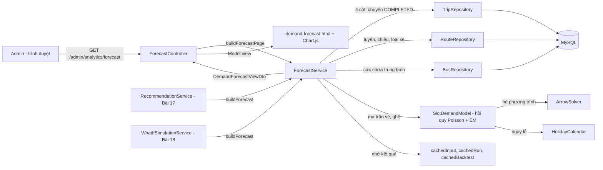
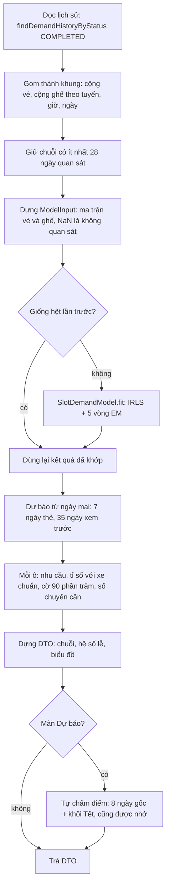
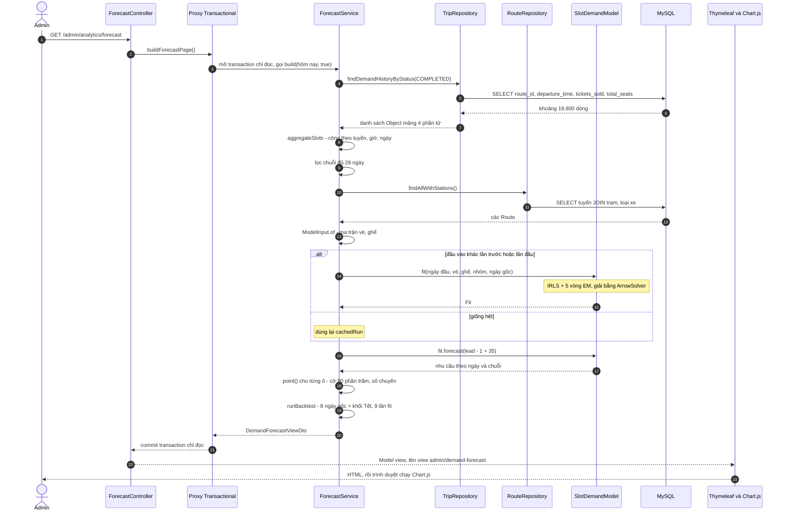
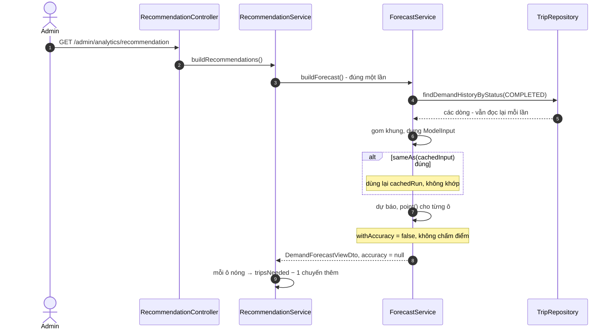

# Bài 14 — Demand Forecast (Dự báo nhu cầu theo khung giờ)

> Bài chức năng thứ mười bốn, sinh từ `docs/ai/03_defense_study_prompt.md` (PHẦN B), ngày 2026-10-23,
> ở GĐ7 của đợt thiết kế lại dự báo. Viết **trước** các bài 07–13 vì phần dự báo là chỗ thầy hướng dẫn
> chất vấn; bài này tự giải thích những gì nó cần từ các bài chưa viết. Số dòng là ảnh chụp ngày viết —
> lệch thì grep lại.
>
> Nhãn: [CODE] đọc thẳng từ code · [SPRING] hành vi chuẩn của Spring/Hibernate mà code không viết ra ·
> [SUY LUẬN] suy luận của người viết ("chưa kiểm chứng" nếu chưa chạy thử).
>
> Viết tắt: `…/` = `src/main/java/giang/com/BusManagement/`, `test/` =
> `src/test/java/giang/com/BusManagement/`, `tpl/` = `src/main/resources/templates/`,
> `FS` = `…/service/ForecastService.java`, `SDM` = `…/service/SlotDemandModel.java`,
> `HC` = `…/domain/HolidayCalendar.java`, `TR` = `…/repository/TripRepository.java`.
>
> **Phạm vi.** Một màn hình, một `GET`: `/admin/analytics/forecast`. Phần nặng nằm trong ba lớp:
> `ForecastService` gom dữ liệu, giữ bộ nhớ đệm và dựng màn hình; `SlotDemandModel` là mô hình;
> `ArrowSolver` là phần đại số. Hai màn khác dùng lại dự báo này: Đề xuất tăng cường (Bài 17) và
> What-if (Bài 18). Dữ liệu lịch sử do bộ sinh của Bài 13 tạo. Bài này có 🧮: §8 bắt buộc tính tay.
> Nguồn lý do: `docs/development/forecast_decisions.md` (QĐ-1…QĐ-17) và roadmap §9.

---

## §1. Chức năng này là gì — nói kiểu đời thường

**Vấn đề thật của nhà xe.** Tuần sau là Tết. Chuyến 06:00 Hà Nội → Hải Phòng thường có 15 khách, nhưng
những ngày trước Tết có thể 45–55 người muốn đi. Nếu tới sát ngày mới biết thì đã muộn: xe và tài xế đã
xếp hết, khách bị bỏ lại. Nhà xe cần biết **trước** — khung giờ nào sẽ đông, đông tới mức cần mấy xe.

Chức năng này **dự báo số khách muốn đi** của từng **khung**: một tuyến, một giờ khởi hành, một ngày.
Nó nhìn lại lịch sử (thứ trong tuần, dịp lễ, xu hướng), dự báo 7 ngày tới cho các thẻ đề xuất và tới 35
ngày để xem trước. Ô nào nhu cầu vượt 90% số ghế của một xe chuẩn thì tô đỏ và ghi "cần N chuyến".

Nó **chỉ dự báo**. Nó không tạo chuyến, không phân công ai: quyết định là của Admin. Đây là module
**duy nhất có tính dự đoán**; các màn khác chỉ báo cáo chuyện đã xảy ra.

**Không có nó thì ai khổ?** Người điều phối phải đoán bằng kinh nghiệm. Mô hình cũ của dự án (trước
GĐ5) dự báo **tỉ lệ lấp đầy**, bị kẹp ở 100%: Tết làm nhu cầu gấp đôi cũng chỉ hiện "100%", nên không
trả lời được câu "cần mấy chuyến" (QĐ-2).

**Một kịch bản cụ thể** (minh hoạ). Ngày 23/10, anh admin mở *Analytics → tab Lấp đầy → Dự báo nhu
cầu*. Trang đứng 4–5 giây (lần mở đầu tiên sau khi app khởi động) rồi hiện:

- bảng 7 ngày: dòng "Hà Nội → Hải Phòng — 06:00" có ô thứ Sáu ghi **20**, "91%", nền đỏ, "cần 2
  chuyến";
- biểu đồ 35 ngày của từng chuỗi;
- bảng hệ số lễ: Tết, chiều "Rời TP lớn", đỉnh ×2,9 ở D−3;
- khối tự chấm điểm: "Sai số số vé 16,1% — SN4 sạch 17,5%".

Anh bấm lại F5: lần này trang hiện ngay, cuối trang ghi *"lần mở này dùng lại kết quả đó vì lịch sử
không đổi"*. Anh chuyển sang màn Đề xuất tăng cường: thẻ của đúng ô đỏ đó đã có xe và tài xế.

---

## §2. Bản đồ tổng quan

### 2.1. Các mảnh ghép

| Loại | File | Trách nhiệm (1 dòng) |
|---|---|---|
| Template | `tpl/admin/demand-forecast.html` | Bảng 7 ngày, biểu đồ 35 ngày, khối tự chấm điểm, khối Tết, bảng hệ số lễ, thông tin lần khớp; hai khối `<script>` vẽ Chart.js |
| JavaScript | `tpl/admin/demand-forecast.html:442-492`, `:494-533` | Dựng biểu đồ từ số liệu Thymeleaf đổ vào; đổi chuỗi khi chọn trong ô `select` (chỉ phía trình duyệt) |
| Controller | `…/controller/admin/ForecastController.java:45-49` | Một `GET`, không tham số, gọi `buildForecastPage()`, đưa vào Model key `view` |
| Service | `FS:212-366` | Hai cửa `buildForecast()` / `buildForecastPage()`; gom khung, chọn chuỗi, gọi mô hình, nhớ kết quả, dựng DTO |
| Service — luật dùng chung | `FS:482-514` | `isHot()`, `tripsNeeded()`, `extraTripPassengers()` — Bài 17, 18 gọi |
| Service — tự chấm điểm | `FS:622-791` | Lùi về 8 ngày gốc, khối Tết, SN4 sạch, chấm điểm |
| Mô hình | `SDM:101-229`, `:585-685` | Hồi quy Poisson theo lịch + EM; `Fit.forecast()` |
| Đại số | `…/service/ArrowSolver.java:47` | Giải hệ "mũi tên" theo khối (bù Schur, Cholesky) |
| Lịch lễ | `HC:89-133`, `…/domain/Holiday.java:22-32` | Ngày nào thuộc dịp lễ nào, lệch mấy ngày; cửa sổ mỗi dịp |
| Entity / enum | `…/domain/Route.java:82-84`, `…/domain/HolidayFlow.java:27-32` | `Route.holidayFlow`: tuyến học hệ số lễ chung với tuyến nào |
| Repository | `TR:483-485` `findDemandHistoryByStatus`; `RouteRepository.java:22-26` `findAllWithStations`; `BusRepository.java:16-17` `findAllWithBusType` | 4 cột lịch sử; tuyến + loại xe; sức chứa trung bình đội xe |
| DTO | `…/dto/DemandForecastViewDto.java`, `ForecastSeriesDto`, `ForecastPointDto`, `ForecastAccuracyDto` | Toàn màn / một chuỗi / một ô / tự chấm điểm |
| Người dùng lại | `…/service/RecommendationService.java:134`, `…/service/WhatIfSimulationService.java:159` | Gọi `buildForecast()` (không tự chấm điểm) |
| Test | `test/service/ForecastServiceTest` (8), `ForecastServiceRulesTest` (10), `ForecastServiceReferenceTest` (4), `SlotDemandModelTest` (8), `SlotDemandModelReferenceTest` (5), `ArrowSolverTest` (2), `test/domain/HolidayCalendarTest` (13) | §9.4 |

### 2.2. Bảng endpoint — đủ mọi điểm bắt đầu

| HTTP / trigger | URL | Controller method | Được gọi từ đâu | Service chính | Kết quả |
|---|---|---|---|---|---|
| GET | `/admin/analytics/forecast` | `ForecastController.viewForecast()` `:46-49` | nút "Dự báo nhu cầu" ở tab Lấp đầy (`tpl/admin/dashboard-analytics.html:409`); ô "Dự Báo Nhu Cầu" ở trang chủ admin (`tpl/admin/dashboard.html:137`) | `buildForecastPage()` `FS:218-221` | view `admin/demand-forecast` |
| (gọi trong Java) | — | — | `RecommendationService.buildRecommendations()` `:134` (Bài 17) | `buildForecast()` `FS:212-215` | `DemandForecastViewDto` không có phần tự chấm điểm |
| (gọi trong Java) | — | — | `WhatIfSimulationService.simulate()` `:159` (Bài 18) | `buildForecast()` | như trên |
| sự kiện `change` (JS) | — | — | ô chọn chuỗi `#previewSeries`, `#tetSeries` | không gọi server | biểu đồ vẽ lại chuỗi khác |

Không có `@Scheduled`: không có job tính dự báo ban đêm. Roadmap §4 cấm cron hằng ngày; dự báo được
tính khi có người mở trang, rồi giữ trong bộ nhớ (§3.2).

### 2.3. Sơ đồ toàn cảnh



Bên trong `build()`, theo thứ tự:



### 2.4. Điều cốt lõi cần nhớ

1. **Đơn vị là khung, đại lượng là nhu cầu.** Khung = tuyến × giờ khởi hành × ngày, cộng mọi chuyến
   `COMPLETED` của khung kể cả chuyến tăng cường. Dự báo số khách **muốn** đi, không kẹp ở số ghế.
2. **Mô hình là thống kê viết tay, không phải máy học:** hồi quy Poisson theo lịch — mức, thứ, xu hướng,
   hệ số lễ học chung theo chiều tuyến và kéo về ×1 — cộng EM để đoán lại nhu cầu của khung bán hết vé.
   Bản Java khớp bản Python đã đo tới 10⁻⁸.
3. **Một định nghĩa "chuyến nóng":** nhu cầu ÷ ghế xe chuẩn > 0,90 — đúng ngưỡng
   `Trip.needsReinforcement()`. Số chuyến cần = max(1, ⌈nhu cầu ÷ (0,9 × ghế)⌉), tính **qua** cờ đó.
4. **Tính một lần, dùng lại tới khi dữ liệu đổi.** Mỗi lần gọi vẫn đọc lại lịch sử; ma trận đầu vào
   giống hệt thì dùng lại kết quả. Không cron, không bảng mới.
5. **Tự chấm điểm trung thực:** chỉ so cái app thấy được — min(dự báo, ghế đã chạy) với số vé — và so
   với một cách làm ngây thơ (SN4 sạch). Trên DB thật: 16,06% so với 17,54%.

---

## §3. Trace chi tiết các luồng chính

**Chọn luồng nào và vì sao.**

- **Luồng A — Mở trang Dự báo lần đầu sau khi khởi động app.** Đi qua mọi tầng: truy vấn, gom khung,
  khớp mô hình (đường chậm), dự báo, tự chấm điểm, Thymeleaf, JavaScript.
- **Luồng B — Một màn khác (Đề xuất) gọi `buildForecast()` khi lịch sử không đổi.** Cho thấy bộ nhớ
  đệm và lý do tách `buildForecast()` khỏi `buildForecastPage()`.

### 3.1. Luồng A — Mở trang Dự báo lần đầu

**(a) Sơ đồ**



**(b) Bảng từng bước**

| # | Tầng | Vị trí | Method / thành phần | Nhận vào | Làm gì | Trả về / gọi tiếp | Nhãn |
|---|---|---|---|---|---|---|---|
| 1 | Trình duyệt | `tpl/admin/dashboard-analytics.html:409` | link "Dự báo nhu cầu" | — | gửi `GET /admin/analytics/forecast` | request | [CODE] |
| 2 | Spring MVC | — | DispatcherServlet | URL | tìm handler theo `@RequestMapping("/admin/analytics/forecast")` + `@GetMapping` | `viewForecast(Model)` | [SPRING] |
| 3 | Controller | `ForecastController.java:46-47` | `viewForecast` | `Model` | gọi `forecastService.buildForecastPage()` — bean được Spring tiêm qua constructor (`@RequiredArgsConstructor`) | proxy | [CODE] |
| 4 | Proxy | `FS:218` | `@Transactional(readOnly = true)` | — | mở transaction **chỉ đọc**: Hibernate không theo dõi thay đổi để ghi | gọi `build(LocalDate.now(), true)` | [SPRING] |
| 5 | Service | `FS:224-225` | `build` | hôm nay | `forecastFrom` = ngày mai; `calendarEnd` = 31/12/2032 | — | [CODE] |
| 6 | Repository | `TR:483-485` | `findDemandHistoryByStatus(COMPLETED)` | trạng thái | JPQL 4 cột, lọc `totalSeats > 0`, sắp theo giờ khởi hành. [SUY LUẬN — SQL tương đương] `SELECT t.route_id, t.departure_time, t.tickets_sold, t.total_seats FROM trips t WHERE t.status = 'COMPLETED' AND t.total_seats > 0 AND (t.is_deleted = false) ORDER BY t.departure_time` — vế `is_deleted` do `@SQLRestriction` của `Trip` thêm | `List<Object[]>` | [CODE]/[SPRING] |
| 7 | Service | `FS:385-407` | `aggregateSlots(rows, today)` | các dòng | bỏ dòng thiếu cột, ghế ≤ 0, ngày sau hôm nay hoặc ngoài lịch lễ; cộng vé và ghế vào `slots[SlotKey(tuyến, giờ)][ngày]` | `SortedMap` khung | [CODE] |
| 8 | Service | `FS:229-232` | lọc chuỗi | các chuỗi | giữ chuỗi có **≥ 28 ngày** quan sát (`MIN_OBSERVED_DAYS`, `:118`); số chuỗi bị bỏ ghi vào `skippedSeriesCount` (`:239`) | `keys` | [CODE] |
| 9 | Service | `FS:245-255` | phạm vi lịch sử | — | ngày đầu, ngày cuối, số ngày đã cũ; **không chuỗi nào đủ** ⇒ trả DTO rỗng ngay (§4) | — | [CODE] |
| 10 | Repository | `RouteRepository.java:22-26` | `findAllWithStations()` | — | nạp tuyến kèm trạm và loại xe trong một câu — tránh `LazyInitializationException` khi lấy tên tuyến (`FS:873-878`) | `Map<Long, Route>` | [CODE] |
| 11 | Service | `FS:259`, `:466-475` | `groupOf(route)` | `Route.holidayFlow` | `LEAVING_HUB` → 0, `TOWARD_HUB` → 1, null → 2 | `int[] groups` | [CODE] |
| 12 | Service | `FS:260`, `:432-450` | `ModelInput.of` | khung, nhóm | ma trận `sales[ngày][chuỗi]`, `seats[ngày][chuỗi]`; ô không quan sát là `NaN` | `input` | [CODE] |
| 13 | Service | `FS:264-275` | `synchronized (cacheLock)` | `input` | `input.sameAs(cachedInput)`? Lần đầu là **không** ⇒ đo giờ, gọi `SlotDemandModel.fit(...)`, lưu `cachedRun`, xoá `cachedBacktest` | `run` | [CODE] |
| 14 | Mô hình | `SDM:101-229` | `fit` | ma trận, nhóm, ngày gốc | dựng cột lịch (thứ, xu hướng, cặp (dịp, ngày lệch)), chia số đếm cho mức chuỗi, IRLS + 5 vòng EM, hệ số chỉnh mức 28 ngày | `Fit` | [CODE] |
| 15 | Mô hình | `SDM:287-388`, `ArrowSolver.java:47` | `irls` → `ArrowSolver.solve` | — | mỗi vòng IRLS giải hệ khoảng 1.400 ẩn theo khối; giảm nửa bước khi mục tiêu tụt | hệ số | [CODE] |
| 16 | Service | `FS:279-282` | dự báo | `lead` = số ngày từ ngày gốc tới ngày mai | `fit.forecast(lead − 1 + previewDays)`, `previewDays` ≤ 35 và không vượt 2032 | `demand[ngày][chuỗi]` | [CODE] |
| 17 | Service | `FS:284-299` | xe chuẩn | `Route.suitableBusType` | sức chứa loại xe của tuyến; tuyến chưa có loại xe ⇒ `fleetAverageCapacity()` (`:530-535`, `BusRepository.findAllWithBusType`) | `standardSeats[]` | [CODE] |
| 18 | Service | `FS:301-324`, `:516-528` | `point(...)` | ngày, nhu cầu, ghế | tỉ số, `isHot`, `tripsNeeded`, nhãn thứ, nhãn lễ → `ForecastPointDto`; 7 ô đầu là `points`, 35 ô là `preview` | `ForecastSeriesDto` | [CODE] |
| 19 | Service | `FS:325-344` | sắp xếp, gắn thông tin | — | chuỗi có tỉ số đỉnh cao nhất lên đầu; thông tin lần khớp, bảng hệ số lễ (`:545-589`), dữ liệu biểu đồ (`:591-607`) | — | [CODE] |
| 20 | Service | `FS:346-364`, `:622-689` | tự chấm điểm | `input` | `cachedBacktest` trống ⇒ `runBacktest`: 8 lần khớp ở 8 ngày gốc + 1 lần cho khối Tết; chấm bằng `score()` (`:724-764`) | `ForecastAccuracyDto` | [CODE] |
| 21 | Proxy | — | kết thúc `buildForecastPage()` | — | commit transaction chỉ đọc (không có gì để ghi) | DTO | [SPRING] |
| 22 | Controller | `ForecastController.java:47-48` | `model.addAttribute("view", …)` | DTO | trả tên view `admin/demand-forecast` | — | [CODE] |
| 23 | View | `tpl/admin/demand-forecast.html:134-184` | bảng 7 ngày | `view.series` | mỗi ô in nhu cầu, %, ô đỏ khi `needsReinforcement` kèm "cần N chuyến" (`:170-181`) | HTML | [CODE] |
| 24 | View | `:440-492` | `th:inline="javascript"` | `view.previewChart` | Thymeleaf in mảng số vào biến JS; trình duyệt tải Chart.js 4.4.1 và vẽ ba đường: nhu cầu, ghế một xe, 90% xe | biểu đồ | [CODE]/[SPRING] |
| 25 | JS | `:484-490` | sự kiện `change` của `#previewSeries` | chỉ số chuỗi | thay dữ liệu ba đường, `chart.update()` — không gọi server | — | [CODE] |

**Ranh giới transaction.** Một transaction chỉ đọc, mở ở bước 4, đóng ở bước 21. `build()` được gọi
từ bên trong `buildForecastPage()` nên không qua proxy lần nữa — đó là gọi nội bộ, không mở thêm
transaction [SPRING].

**(c) Trích code then chốt**

`FS:396-404` — gom một dòng lịch sử vào khung của nó:

```java
LocalDateTime departure = (LocalDateTime) row[1];            // giờ khởi hành của chuyến
LocalDate date = departure.toLocalDate();                     // ngày của khung
if (date.isAfter(today) || !HolidayCalendar.covers(date)) {  // sau hôm nay, hoặc ngoài lịch lễ 2023–2032
    continue;                                                 // → bỏ: chưa là lịch sử / lịch sẽ ném lỗi
}
int[] total = slots.computeIfAbsent(new SlotKey(((Number) row[0]).longValue(), departure.getHour()),
        k -> new TreeMap<>()).computeIfAbsent(date, d -> new int[2]);  // khung (tuyến, giờ) → (ngày) → {vé, ghế}
total[0] += sold;                                             // cộng vé: chuyến chính + chuyến thêm cùng giờ
total[1] += seats;                                            // cộng ghế đã chạy
```

Chuyến tăng cường khởi hành phút 30/40/50, cùng **giờ** với chuyến gốc, nên `departure.getHour()` tự
đưa nó vào đúng khung.

`FS:229-232` — giữ chuỗi đủ 28 ngày:

```java
List<SlotKey> keys = slots.entrySet().stream()
        .filter(e -> e.getValue().size() >= MIN_OBSERVED_DAYS)   // số NGÀY quan sát của chuỗi
        .map(Map.Entry::getKey)
        .toList();
```

Viết lại bằng vòng `for`:

```java
List<SlotKey> keys = new ArrayList<>();
for (Map.Entry<SlotKey, SortedMap<LocalDate, int[]>> e : slots.entrySet()) {
    if (e.getValue().size() >= MIN_OBSERVED_DAYS) {   // map ngày → khung: size() = số ngày có chuyến hoàn thành
        keys.add(e.getKey());
    }
}
```

`FS:264-275` — bộ nhớ đệm:

```java
synchronized (cacheLock) {                       // hai request cùng lúc không khớp hai lần
    reused = input.sameAs(cachedInput);          // so NGUYÊN ma trận, không so "dấu vân tay"
    if (!reused) {
        long started = System.nanoTime();
        SlotDemandModel.Fit fit = SlotDemandModel.fit(input.firstDay, input.sales, input.seats,
                input.groups, input.origin);     // phần chậm: 0,2–0,6 giây
        cachedRun = new ModelRun(fit, (System.nanoTime() - started) / 1_000_000, LocalDateTime.now());
        cachedInput = input;
        cachedBacktest = null;                   // phần chấm điểm thuộc về đầu vào cũ
    }
    run = cachedRun;
}
```

`FS:482-496` — một định nghĩa "chuyến nóng":

```java
static boolean isHot(double demand, int standardSeats) {
    return standardSeats > 0 && demand / standardSeats > REINFORCEMENT_THRESHOLD;   // > 0,90
}

static int tripsNeeded(double demand, int standardSeats) {
    if (!isHot(demand, standardSeats)) {      // đi QUA cờ, không tự chia lại
        return 1;
    }
    return Math.max(2, (int) Math.ceil(demand / (REINFORCEMENT_THRESHOLD * standardSeats)));
}
```

`SDM:198-208` — EM:

```java
for (int round = 0; round <= EM_ROUNDS; round++) {           // 0 = lần khớp đầu, rồi 5 vòng EM
    double[] scaled = new double[observations];
    for (int i = 0; i < observations; i++) {
        scaled[i] = target[i] / scale[rows.series[i]];       // chia cho mức trung bình của chuỗi
    }
    iterations += irls(rows, dayColumns, dayValues, dayKeys, groups, scaled, beta, knotCount);  // bước M
    if (round == EM_ROUNDS) {
        break;                                               // vòng cuối không cần bước E nữa
    }
    nbSize = expectationStep(rows, dayColumns, dayValues, dayKeys, groups, scale, beta, target); // bước E
}
```

`SDM:440-444` — bước E thay số vé của khung bán hết:

```java
for (int i = 0; i < rows.size; i++) {
    if (rows.sales[i] >= rows.cap[i]) {                          // bán hết: chỉ biết "nhu cầu ≥ số ghế"
        target[i] = meanAtLeast(mu[i], rows.cap[i], size);       // thay bằng E[nhu cầu | nhu cầu ≥ ghế]
    }
}
```

### 3.2. Luồng B — Màn Đề xuất gọi `buildForecast()` khi lịch sử không đổi



| # | Tầng | Vị trí | Làm gì | Nhãn |
|---|---|---|---|---|
| 1–2 | Controller → Service | `RecommendationController`, `RecommendationService.java:129-134` | mở transaction chỉ đọc của `buildRecommendations()`, gọi `buildForecast()` **một lần** cho cả request | [CODE] |
| 3 | Proxy | `FS:212` | `buildForecast()` cũng `@Transactional(readOnly = true)`; đang có transaction bên ngoài nên **tham gia** transaction đó (mặc định `REQUIRED`) | [SPRING] |
| 4–5 | Service, Repository | `FS:227-260` | đọc lại 4 cột và dựng lại ma trận — rẻ hơn nhiều so với một lần khớp: cả trang Dự báo khi dùng lại kết quả chỉ mất 0,16–0,6 giây trên DB thật | [CODE] |
| 6 | Service | `FS:264-275` | ma trận giống hệt ⇒ `reused = true`, dùng `cachedRun` | [CODE] |
| 7 | Service | `FS:346` | `withAccuracy = false` ⇒ bỏ qua 9 lần khớp của phần tự chấm điểm | [CODE] |
| 8 | Service | `RecommendationService.java:181-187` | ô có `needsReinforcement` ⇒ `tripsNeeded − 1` chuyến thêm, hỏi `ForecastService.extraTripPassengers` mỗi chuyến chở bao nhiêu khách (Bài 17) | [CODE] |

**Vì sao tách hai cửa.** Phần tự chấm điểm cần 9 lần khớp thêm (2–3 giây). Chỉ màn Dự báo hiện nó;
Đề xuất và What-if chỉ cần dự báo. Tách ra thì hai màn đó không bao giờ trả chi phí này (QĐ-16, G5-4).
Nếu lịch sử đổi dù một vé, `sameAs` sai, mô hình khớp lại và `cachedBacktest` bị xoá (`FS:272`).

---

## §4. Luồng lỗi — Bản cài mới, chưa có lịch sử

Màn này không có thao tác ghi, nên không có "lưu thất bại". Luồng thất bại có thật là **không có dữ
liệu để học**, ví dụ ngay sau khi chạy profile `demo` mà chưa chạy `backfill`.

1. `findDemandHistoryByStatus(COMPLETED)` trả danh sách rỗng hoặc rất ít dòng.
2. `aggregateSlots` cho ra vài khung; không chuỗi nào đủ 28 ngày ⇒ `keys` rỗng (`FS:229-232`).
3. `FS:253-255`: `if (keys.isEmpty()) return view;` — trả DTO với `series` rỗng, `model = null`,
   `accuracy = null`. **Không ném exception nào**, transaction chỉ đọc kết thúc bình thường.
4. Template `tpl/admin/demand-forecast.html:185-194` hiện *"Chưa đủ dữ liệu lịch sử để dự báo. Mỗi nhóm
   (tuyến × khung giờ) cần ít nhất 28 ngày có chuyến đã hoàn thành"* kèm đúng lệnh
   `mvnw spring-boot:run -Dspring-boot.run.profiles=backfill`. Khối tự chấm điểm, biểu đồ, bảng hệ số lễ
   tự ẩn nhờ các `th:if` (`:214`, `:232`, `:363`, `:422`).
5. Màn Đề xuất nhận cùng DTO rỗng ⇒ 0 thẻ; What-if ghi "chưa có dữ liệu" (`dataAvailable = false`).

Test giữ luồng này: `ForecastServiceTest.noHistory_givesAnEmptyForecast_notAnError` (`:206`); case thủ
công TC_FC_008.

**Một luồng lỗi đã được chặn trước.** `HolidayCalendar.holidaysOn()` **ném**
`IllegalArgumentException` cho ngày ngoài 2023–2032 (`HC:114-119`). Nếu DB có một chuyến ngày 2033 mà
`aggregateSlots` không lọc, exception sẽ bay ra khỏi `SlotDemandModel.fit` khi dựng cột lịch → ra khỏi
method `@Transactional` (chỉ đọc, không có gì để hoàn tác) → không có `@ControllerAdvice` nào trong
project bắt nó → Spring Boot trả trang lỗi 500 mặc định [SPRING]. Dòng `FS:398-400` bỏ những ngày đó
trước, nên trang không bao giờ sập vì lý do này. Dự báo cũng không vượt 31/12/2032 (`FS:280-281`), và
màn hình báo khi 35 ngày xem trước chạm mốc ấy (`tpl/admin/demand-forecast.html:53-60`).

---

## §5. Các luồng còn lại — trace rút gọn

- **What-if (Bài 18):** `WhatIfController` → `WhatIfSimulationService.simulate()` → `buildForecast()`
  (`:159`) → nhân hệ số kịch bản vào nhu cầu → `ForecastService.tripsNeeded(nhu cầu × hệ số, ghế)`
  (`:254`). Ở 100% nhu cầu, số chuyến thêm bằng số thẻ Đề xuất vì cùng một hàm.
- **Trang chủ admin:** `tpl/admin/dashboard.html:137` chỉ là một link tới cùng `GET`.
- **Ô chọn chuỗi của khối Tết** `#tetSeries` (`tpl/admin/demand-forecast.html:524-531`): JS đổi dữ liệu
  bốn đường của biểu đồ Tết (vé thật, ghế đã chạy, mô hình, SN4), không gọi server.

---

## §6. Hai lớp bảo vệ và tác động lên dữ liệu

### 6.1. Bảng "không-mời / chặn thật"

Màn này chỉ đọc, nên "luật" ở đây là luật **chọn dữ liệu** và luật **diễn giải**:

| Luật | Lớp không-mời | Lớp chặn thật | Ghi chú |
|---|---|---|---|
| Chỉ chuyến `COMPLETED` làm nên lịch sử | — | `FS:228` truyền `TripStatus.COMPLETED`; `TR:483-484` lọc `status` | Chuyến `CANCELLED` giữ số vé bán trước khi hủy; gộp vào là trộn nhu cầu không được phục vụ (roadmap §9) |
| Chuyến 0 ghế không tính | — | `TR:484` `totalSeats > 0`; lưới an toàn `FS:393-395` | Một lớp ở DB, một lớp phòng thủ ở service |
| Chuỗi phải đủ 28 ngày | — | `FS:229-232` | Nhóm bị bỏ được đếm và hiện ("bỏ qua N nhóm thiếu dữ liệu", `tpl:71-73`) |
| Ngày ngoài 2023–2032 không dùng | — | `FS:398`; `HC` ném lỗi nếu lọt | §4 |
| "Cần tăng cường" chỉ một định nghĩa | màn hình chỉ tô đỏ theo `needsReinforcement` (`tpl:171`) | `FS:482-496` | Bài 17, 18 gọi lại đúng các hàm này |
| Không tạo chuyến, không phân công | không có nút nào trên trang | không có method ghi nào trong `ForecastService` | — |

### 6.2. Bảng "thay đổi gì trong DB"

| Thao tác | Bảng / cột đổi |
|---|---|
| Mở `/admin/analytics/forecast` | **Không ghi DB.** Chỉ `SELECT` trên `trips`, `routes`, `route_stations`, `stations`, `bus_types` (và `buses` khi có tuyến chưa có loại xe) |
| Kết quả khớp | Giữ trong **bộ nhớ** của tiến trình Java (`cachedInput`, `cachedRun`, `cachedBacktest`, `FS:202-205`); khởi động lại app là mất, lần mở sau khớp lại |

---

## §7. Annotation và cơ chế dùng trong chức năng này

| Annotation / cơ chế | Nghĩa đời thường | Tác dụng ở đây | Bỏ đi thì sao |
|---|---|---|---|
| `@Controller` + `@RequestMapping` + `@GetMapping` (`ForecastController.java:30-31`, `:45`) | "Quầy lễ tân nhận yêu cầu tới địa chỉ này" (Bài 00a) | URL `/admin/analytics/forecast` vào `viewForecast` | 404 |
| `@RequiredArgsConstructor` (Lombok) | "Tự viết constructor nhận mọi field `final`" | Spring tiêm `ForecastService` vào controller, ba repository vào service (`FS:101-106`) | Phải tự viết constructor |
| `@Service` (`FS:100`) | "Đăng ký làm nhân viên xử lý" | Một bean duy nhất ⇒ **một** bộ nhớ đệm cho cả ba màn | Không tiêm được; nhiều bản ⇒ nhiều bộ nhớ đệm |
| `@Transactional(readOnly = true)` (`FS:212`, `:218`) | "Phiên làm việc chỉ đọc" (Bài 00b) | Hibernate không theo dõi thay đổi; LAZY load được trong phiên | Mỗi câu repository thành một transaction riêng; nhờ JOIN FETCH và open-in-view (mặc định bật) trang có lẽ vẫn chạy, nhưng mất lời hứa "chỉ đọc" và Bài 17, 18 không còn đọc chung một ảnh chụp [SUY LUẬN — chưa kiểm chứng] |
| `record` (`FS:177-200`) | "Class chỉ để chở dữ liệu, viết một dòng" (Bài 00a §2.5) | `SlotKey` có sẵn `equals/hashCode` nên làm khóa Map được; `implements Comparable` để làm khóa `TreeMap` | Phải tự viết `equals/hashCode`, dễ sai |
| `TreeMap` / `SortedMap` (`FS:385-406`) | "Tủ hồ sơ tự xếp theo thứ tự" | Chuỗi xếp theo tuyến rồi giờ, ngày xếp tăng dần ⇒ ma trận dựng đúng thứ tự, đối chiếu được với Python | Thứ tự chuỗi ngẫu nhiên; nhóm số không khớp file tham chiếu |
| `synchronized (cacheLock)` (`FS:264`, `:348`) | "Một người dùng phòng tại một thời điểm" | Hai request cùng lúc không khớp hai lần và không đọc bộ nhớ đệm đang ghi dở | Có thể khớp trùng, hoặc đọc `cachedRun` lệch `cachedInput` |
| `Double.NaN` (`FS:439-440`) | "Ô để trống có chủ đích" | Khung không có chuyến hoàn thành = **không quan sát**, khác hẳn "0 khách" | Ngày bão thành "nhu cầu bằng 0" — mô hình học sai |
| `static` package-private (`FS:482-514`) | "Hàm thuần dùng chung trong cùng gói" | `RecommendationService`, `WhatIfSimulationService` cùng gói `service` gọi được; test gọi thẳng không cần Spring | Mở `public` thì lộ ra ngoài gói; để `private` thì hai màn kia phải chép lại ngưỡng |
| `th:inline="javascript"` + `/*[[${…}]]*/` (`tpl:442-447`) | "Thymeleaf đổ số liệu vào biến JavaScript" | Danh sách Java thành mảng JS cho Chart.js | Phải tự dựng chuỗi JSON |
| `@SQLRestriction` trên `Trip` (Bài 00b) | "Điều kiện ngầm cho mọi câu SELECT" | Chuyến xóa mềm không vào lịch sử | Chuyến đã xóa vẫn thành nhu cầu |

---

## §8. Ví dụ tính tay

Số liệu **minh hoạ** trừ chỗ ghi "DB thật". Mọi con số nhị thức âm dưới đây tính bằng scipy với tham số
size = 82,2 — đúng size của lần khớp trên DB thật ngày 21/10/2026.

### 8.1. Gom khung

Tuyến 1, 06:00, một ngày Tết. DB có: chuyến chính 06:00 xe 22 chỗ bán 22 vé (`COMPLETED`); chuyến thêm
06:30 xe 40 chỗ bán 9 vé (`COMPLETED`); không có chuyến nào bị hủy.

- `aggregateSlots` (`FS:401-404`): khung (tuyến 1, giờ 6, ngày đó) = {22 + 9, 22 + 40} = **{31 vé, 62
  ghế}**.
- 31 < 62 ⇒ khung **không** bán hết, dù chuyến chính đầy: nhu cầu thật quan sát được là 31.
- Một ngày khác chỉ có chuyến chính 22/22 ⇒ {22, 22} ⇒ bán hết ⇒ EM sẽ đoán lại (8.3).
- Một ngày bão, cả hai chuyến `CANCELLED` ⇒ không dòng nào ⇒ ô `NaN` — không quan sát.

### 8.2. Một ô dự báo đi qua mô hình

Mô hình cộng các hệ số trên thang log, tức **nhân** chúng trên thang thường (`SDM:266-277`, `:640-641`).
Giả sử chuỗi "Tuyến 1 — 06:00" có:

| Thành phần | Hệ số (thang thường) |
|---|---|
| Mức chuỗi × hệ số mức khi khớp | 16 khách (thứ Hai thường) |
| Thứ Sáu (so với thứ Hai) | ×1,25 |
| Tết D−3, nhóm "Rời TP lớn" (phần gộp) | ×1,9 |
| Phần lệch riêng của chuỗi ở Tết D−3 | ×1,05 |
| Xu hướng đóng băng tại ngày gốc | ×1,02 |
| Hệ số chỉnh mức 28 ngày (`SDM:225`) | ×0,98 |

Nhu cầu = 16 × 1,25 × 1,9 × 1,05 × 1,02 × 0,98 = 20 × 1,9 = 38 → × 1,05 = 39,9 → × 1,02 = 40,70 →
× 0,98 = **39,9 khách**.

Xe chuẩn 22 chỗ: tỉ số 39,9 ÷ 22 = 1,81 > 0,90 ⇒ **cần tăng cường**; số chuyến =
⌈39,9 ÷ (0,9 × 22)⌉ = ⌈39,9 ÷ 19,8⌉ = ⌈2,015⌉ = **3** ⇒ 2 chuyến thêm.

Ghi chú: ngày dự báo nào có cặp (dịp, ngày lệch) **chưa từng gặp** khi học thì không có hệ số lễ cho cặp
đó — `SDM:630-636` bỏ qua khóa không có trong `keyIndex`.

### 8.3. Bước E của EM

Khung bán hết 22/22. Mô hình đang tin nhu cầu kỳ vọng hôm đó là μ = 20.

- Với nhị thức âm (μ = 20, size 82,2), xác suất nhu cầu ≥ 22 là **0,365**.
- `meanAtLeast(20, 22, 82,2)` (`SDM:455-463`) = E[nhu cầu | nhu cầu ≥ 22] = **25,2**.
- Vòng sau, mô hình học khung này như thể có 25,2 khách chứ không phải 22. Nếu μ đang là 26 thì giá
  trị thay thế là 28,2.

Vì sao không lấy luôn μ = 20? Vì ta **biết** hôm đó ít nhất 22 người tới; con số phải ≥ 22. Vì sao không
giữ 22? Vì 22 chỉ là trần của xe, giữ nguyên thì mô hình học rằng nhu cầu không bao giờ vượt một xe —
đúng lỗi của mô hình cũ.

### 8.4. Ngưỡng 90% và số chuyến — kể cả cái bẫy làm tròn

| Nhu cầu | Ghế xe chuẩn | Tỉ số | `isHot` | `tripsNeeded` |
|---|---|---|---|---|
| 19,0 | 22 | 0,864 | không | 1 |
| 19,9 | 22 | 0,905 | có | max(2, ⌈19,9 ÷ 19,8⌉ = 2) = **2** |
| 57,6 (DB thật, tuyến 4, 18:00, 25/10) | 40 | 1,44 | có | ⌈57,6 ÷ 36⌉ = ⌈1,6⌉ = **2** |
| 53,8 (DB thật, tuyến 1, 06:00, 13/02/2026) | 22 | 2,45 | có | ⌈53,8 ÷ 19,8⌉ = ⌈2,72⌉ = **3** |

**Cái bẫy (roadmap §9, ghi chú GĐ5).** Với xe 21 chỗ, 0,9 × 21 trong máy tính là
18,900000000000002. Nhu cầu đúng bằng số đó: 18,900000000000002 ÷ 21 > 0,9 ⇒ **nóng**, nhưng
⌈18,900000000000002 ÷ 18,900000000000002⌉ = 1. Nếu tính số chuyến **độc lập** với cờ, một ô vừa "cần tăng
cường" vừa "cần 1 chuyến". Vì vậy `tripsNeeded` đi **qua** `isHot` và lấy `max(2, …)` (`FS:491-496`).
`ForecastServiceRulesTest.reinforcementFlag_andTripsNeeded_areOneDefinition` thử đúng các cỡ xe 13, 21,
26, 37, 42 chỗ.

### 8.5. Chấm điểm: vì sao min(dự báo, số ghế)

**DB thật**, tuyến 1, 06:00, 13/02/2026: mô hình dự báo **53,8**; hôm đó chạy một xe 22 chỗ, bán **22**
vé (bán hết); nhu cầu thật (bộ sinh xuất ra, app không biết) là **64**.

- Chấm thẳng nhu cầu với số vé: |53,8 − 22| = **31,8** khách sai — phạt mô hình đúng lúc nó **đúng**.
- Cách của app (`FS:738`): |min(53,8; 22) − 22| = **0**.
- Mốc SN4 (minh hoạ, giả sử 17): |min(17; 22) − 22| = 5.

WAPE = Σ|sai| ÷ Σ vé thật (`FS:757-758`). Trên DB thật, 8 tuần cuối: mô hình **16,06%**, SN4 sạch
**17,54%**; Tết 2026: **19,83%** so với **35,92%**.

### 8.6. SN4 sạch

Dự báo cho một thứ Sáu từ ngày gốc là Chủ nhật (`FS:697-713`). Đi lùi theo các thứ Sáu ≤ ngày gốc:

| Thứ Sáu (mới → cũ) | Loại ngày | Vé | Tính vào 4 ngày? | Vào trung bình? |
|---|---|---|---|---|
| F1 | thường | 19 | có (1) | có |
| F2 | trong cửa sổ lễ | 35 | **không** — bỏ hẳn | không |
| F3 | thường, không quan sát (bão) | — | có (2) | không |
| F4 | thường | 21 | có (3) | có |
| F5 | thường | 17 | có (4) | có |

SN4 sạch = (19 + 21 + 17) ÷ 3 = **19,0**. Ngày lễ bị **bỏ** để mốc so sánh không được lợi nhờ đỉnh lễ;
ngày không quan sát vẫn **chiếm chỗ** trong 4 ngày nhưng không vào trung bình.

### 8.7. Khách tràn kỳ vọng của một chuyến thêm

Khung dự báo **30** khách, xe chuẩn 22 chỗ. `tripsNeeded` = ⌈30 ÷ 19,8⌉ = 2 ⇒ 1 chuyến thêm.

- EO(c) = E[(nhu cầu − c)⁺] = số khách kỳ vọng **không có chỗ** khi khung có c ghế (`SDM:473-482`).
- EO(22) = **8,25**; EO(44) = 0,06.
- Chuyến thêm thứ nhất (xe 22 chỗ) chở `extraTripPassengers(30, 22, 22, 82,2)` = EO(22) − EO(44) =
  **8,20** khách (`FS:511-514`).
- Không phải 30 − 22 = 8 (cách trừ thẳng — ở khung 90–100% nó luôn ra 0), cũng không phải 22 (coi chuyến
  thêm chở đầy như cầu nối GĐ5).

Tiền, với số của tuyến 1 (120 km, 120 phút, giá vé 120.000đ, chi phí mặc định 6.000đ/km và 50.000đ/giờ):
chi phí = 6.000 × 120 + 50.000 × 2 = 820.000đ; doanh thu = 8,20 × 120.000 ≈ 984.000đ ⇒ lãi khoảng
+164.000đ. Một chuyến thêm của tuyến này cần khoảng 820.000 ÷ 120.000 ≈ **6,8** khách tràn mới hoà vốn.
Phần này thuộc Bài 17; ở đây chỉ cần nhớ: **con số khách của chuyến thêm cũng đến từ dự báo**.

---

## §9. Vì sao thiết kế như vậy + cạm bẫy + kiểm thử

### 9.1. Các quyết định thiết kế

| Quyết định | Tránh được gì | Vì sao không làm đơn giản hơn | Nguồn |
|---|---|---|---|
| Dự báo **nhu cầu của khung**, không phải tỉ lệ lấp đầy | Tỉ lệ kẹp ở 100% ⇒ không thấy nhu cầu vượt một xe, không trả lời "cần mấy chuyến" | Dự báo số vé cũng sai: vé bị chặn ở số ghế | QĐ-2; roadmap §9 (note "occupancy RATE", nay SUPERSEDED) |
| Hồi quy Poisson theo lịch, học chung mọi chuỗi | Hồi quy tuyến tính kéo thẳng xu hướng; thua cả "trung bình 4 tuần cùng thứ" trên backtest | Holt-Winters không nhận biến ngày lễ; LightGBM/Prophet cần thư viện ML (Non-Goal §4) | QĐ-1, QĐ-6; `forecast_discussion.md` §0, §12 |
| EM cho khung bán hết | Mô hình học rằng nhu cầu không bao giờ vượt số ghế | Bỏ qua khung bán hết = bỏ đúng những ngày đông nhất | QĐ-1; `forecast_discussion.md` §12.7 |
| Hệ số lễ gộp theo **chiều tuyến** (`Route.holidayFlow`) | Tuyến rời TP và tuyến về TP có đỉnh lệch nhau; gộp chung thì triệt tiêu | Admin chọn nhãn vì "TP lớn" là phán đoán nghiệp vụ, không suy được từ cấp hành chính | QĐ-4, QĐ-8 |
| Hệ số lễ kéo về ×1 bằng ridge λ = 2 (quy tắc (b)) | Dịp mới thấy một lần cho hệ số cực đoan | Quy tắc "ít nhất 2 lần" cho kết quả trái ngược giữa hai bộ dữ liệu | QĐ-3 |
| Lịch lễ là **code**, bảng âm lịch tra sẵn | Lịch là sự thật như thứ trong tuần, không phải tham số của nhà xe | Thư viện lịch Trung Quốc sai Tết 2030 (GMT+8) | QĐ-9 |
| Xu hướng **đóng băng** tại ngày gốc | Kéo thẳng xu hướng ra tương lai — đúng lỗi của mô hình cũ | — | QĐ-1 |
| Một ngưỡng 0,90, số chuyến tính qua cờ | Hai định nghĩa "chuyến nóng" lệch nhau ở sát ngưỡng (8.4) | — | QĐ-16 G5-6; roadmap §9 (GĐ5) |
| Nhớ trong bộ nhớ, so **nguyên** ma trận | Cron bị cấm (§4); "dấu vân tay" đếm + tổng bỏ lọt hai thay đổi bù nhau | — | QĐ-16 G5-4 |
| Tự chấm bằng min(dự báo, ghế) với số vé | Phạt mô hình đúng lúc nó đúng; chỉ chấm khung chưa bán hết là chọn mẫu theo kết quả | — | QĐ-16 G5-7; `forecast_discussion.md` §15 |
| Bản Java bị **khoá** vào kết quả Python | Con số đo được ở nghiên cứu là của một chương trình khác | — | QĐ-15; roadmap §9 (GĐ4) |
| Giải hệ theo khối "mũi tên" (`ArrowSolver`) | Giải thẳng 1.400 ẩn tốn cỡ một tỉ phép tính mỗi vòng | — | QĐ-15 G4-4 |

### 9.2. Bug thật đã từng xảy ra quanh chức năng này

- **Mô hình cũ thua cách ngây thơ** (2026-10-14 → 16). Thầy nhận xét *"nếu dùng hồi quy tuyến tính thì
  khả năng cao là đang sai"*. Backtest 8 thời điểm: mô hình cũ 4,94% MAPE, "trung bình 4 lần cùng thứ"
  4,68%, Holt-Winters 4,56%. Gốc hiểu sai: **xu hướng kéo thẳng** và **đơn vị bị kẹp** — dữ liệu lúc đó
  còn được sinh đúng bằng công thức "đường thẳng × hệ số tuần", nên mọi đánh giá đều thiên vị cho nó
  (`forecast_discussion.md` §0.1). Sửa: thiết kế lại (QĐ-1…QĐ-7).
- **#31 — xu hướng của bộ sinh cũ reset sau mỗi lần chạy bổ sung.** Bộ sinh tính xu hướng từ "hôm nay
  − 84" nên mỗi lần chạy lại tạo một bậc tụt: dữ liệu dự báo học có hình răng cưa. Gốc hiểu sai: một bộ
  sinh "chạy bổ sung" phải tất định theo **ngày**, không theo **ngày chạy**. Sửa ở GĐ2 (mốc cố định
  01/01/2023), dữ liệu cũ xoá ở GĐ3.
- **#32, #33 — bộ sinh cũ xếp chuyến cho tài xế hết hạn bằng, và không né xe/người của chuyến có sẵn.**
  Đây là dữ liệu dự báo học, nên lỗi ở bộ sinh là lỗi ở đầu vào của mô hình. Sửa ở GĐ2–GĐ3.
- **Cái bẫy làm tròn ở xe 21 chỗ** (GĐ5, 8.4): lần thử "tính số chuyến tách khỏi cờ" ban đầu **không**
  làm đỏ test nào, vì test chưa có giá trị sát ngưỡng. Thêm các cỡ xe 13, 21, 26, 37, 42 chỗ mới bắt được.
  Bài học: test phải có giá trị **ở đúng biên**.
- **Cách chấm điểm làm mô hình trông kém hơn** (GĐ5): so thẳng nhu cầu với số vé cho 20,11% so với
  18,28% của SN4 — mô hình "thua" vì nó đúng ở khung bán hết. Sửa cách chấm, không sửa mô hình.
- **What-if dưới 100% nhu cầu báo 0 khung đông** (cầu nối GĐ5): hệ số nhân vào tỉ lệ đã kẹp 100%. Đã sửa
  ở GĐ6 bằng cách cho What-if gọi thẳng `tripsNeeded` trên số khách.

### 9.3. Cạm bẫy và điểm lạ (ghi lại, không sửa)

- **Lần mở đầu tiên chậm** (3,6–7,3 giây trên DB thật: lần khớp chính + 9 lần tự chấm). Lần sau
  0,16–0,6 giây. Khởi động lại app là mất bộ nhớ đệm.
- **Bộ nhớ đệm sống trong một tiến trình.** Chạy hai bản app thì mỗi bản khớp riêng — không sai, chỉ tốn.
- **Dịp lễ chưa gặp khi học thì không có hệ số.** Ví dụ một ngày lệch mới của Tết nằm ngoài lịch sử ⇒ ô
  đó được dự báo như ngày thường (8.2).
- **Lịch lễ dừng ở 31/12/2032.** Màn hình chỉ cảnh báo khi 35 ngày xem trước chạm mốc này; phải bổ
  sung bảng âm lịch trước đó (roadmap Hidden Cost #10).
- **Dữ liệu cũ dần.** Lịch sử kết thúc ở ngày cuối được sinh; xu hướng vẫn đóng băng ở ngày gốc, nên
  ngày gốc càng xa thì dự báo càng kém tin. Trang ghi "dữ liệu kết thúc cách đây N ngày".
- **Chuỗi giờ lẻ bị bỏ.** Chuyến Admin tự tạo lúc 13:00, 21:00… không đủ 28 ngày nên không được dự báo;
  trang đếm chúng ("bỏ qua N nhóm").
- **Ranh giới đúng đắn của khớp Python:** khớp tới 10⁻⁸ chứng minh bản Java **là** mô hình đã đo, không
  chứng minh mô hình đúng ngoài đời (`forecast_discussion.md` §14.3).
- Javadoc trong code đã được rà ở GĐ7 (2026-10-23): các câu "tới GĐ1 chưa nơi nào gọi" trong
  `HolidayCalendar`, `HolidayFlow`, `SlotDemandModel` đã sửa theo code hiện tại.

### 9.4. Test đang giữ chức năng này

| Test | Chốt luật gì |
|---|---|
| `ForecastServiceRulesTest` (10, JUnit thuần) | chuyến cùng tuyến/giờ/ngày gộp một khung; cờ và số chuyến là một định nghĩa; chuyến thêm chỉ chở khách tràn, chuyến sau chở ít hơn chuyến trước; SN4 sạch bỏ ngày lễ; chấm điểm kẹp ở số ghế; chấm tập rỗng ra "không xác định" chứ không 0; nhãn lễ; nhóm chiều đánh số như Python; `ModelInput.sameAs` |
| `ForecastServiceTest` (8, qua DB test) | khung đều được dự báo bằng số khách từ ngày mai; chỉ `COMPLETED`, chuyến thêm vào khung gốc; chuỗi < 28 ngày bị bỏ và được đếm; khung gần đầy cần 2 chuyến; khung bán hết được dự báo **trên** số ghế; lần gọi thứ hai dùng lại kết quả tới khi đổi một vé; trang chấm 8 tuần cuối; không lịch sử ⇒ dự báo rỗng, không lỗi |
| `ForecastServiceReferenceTest` (4) | khung do service dựng cho ra đúng dự báo Python; 8 ngày gốc mỗi tuần; điểm số bằng file tham chiếu; khối Tết học tới 3 tuần trước Tết |
| `SlotDemandModelTest` (8) | nhu cầu hằng số; hệ số thứ; xu hướng đóng băng; hệ số lễ học được và áp vào dự báo; EM kéo khung bán hết lên trên số ghế; dữ liệu sau ngày gốc bị bỏ qua; tính chất của trung bình phần đuôi; đầu vào sai bị từ chối |
| `SlotDemandModelReferenceTest` (5) | 1.050 dự báo khớp Python tới 10⁻⁶ (thực tế 9,7·10⁻⁹); 402 hệ số lễ; bước E và khách tràn khớp scipy; một lần khớp đủ nhanh |
| `ArrowSolverTest` (2) | nghiệm trùng khử Gauss trên hệ ngẫu nhiên cỡ thật; ma trận không xác định dương bị từ chối |
| `HolidayCalendarTest` (13) | ngày Tết, Giỗ Tổ 2023–2032 (kể cả Tết 2030 theo GMT+7); cửa sổ; từ chối ngoài phạm vi; hai dịp chồng nhau |

Mỗi test được thử "làm hỏng code cho nó đỏ" khi viết (GĐ4: 5 lần, GĐ5: 11 lần, GĐ6: 15 lần) — xem
`forecast_progress.md` mục 3.

### 9.5. Liên kết

- **Bị ảnh hưởng bởi:** bộ sinh lịch sử (Bài 13) — mọi con số học từ đó; Quản lý tuyến (Bài 03) —
  `holidayFlow` đổi nhóm học hệ số lễ, `suitableBusType` đổi xe chuẩn và ngưỡng; FSM (Bài 05) — chỉ chuyến
  `COMPLETED` vào lịch sử.
- **Ảnh hưởng tới:** Đề xuất tăng cường (Bài 17) — số thẻ, số khách mỗi chuyến thêm; What-if (Bài 18) —
  số chuyến thêm cần ở mọi mức nhu cầu.
- **Không liên quan:** bộ quét chuyến nóng thời gian thực `TripService.scanAndSuggestExtraTrips()` (Bài
  08) vẫn dùng vé thật và `Trip.needsReinforcement()`; nó không đọc dự báo.

---

## §10. Chuẩn bị bảo vệ

### 10.1. Tóm tắt 1 phút

> Màn Dự báo nhu cầu dự báo số khách muốn đi của từng khung — một tuyến, một giờ khởi hành, một ngày —
> cho 7 ngày tới và xem trước 35 ngày. Em không dự báo tỉ lệ lấp đầy như bản đầu, vì tỉ lệ bị kẹp ở 100%
> nên không thấy được nhu cầu vượt một xe. Mô hình là hồi quy Poisson theo lịch viết tay bằng Java: mức,
> thứ trong tuần, xu hướng, và hệ số lễ học chung theo chiều tuyến, kéo về một khi ít dữ liệu. Khung bán
> hết vé chỉ cho biết nhu cầu lớn hơn số ghế, nên em dùng EM để đoán lại. Ô nào nhu cầu vượt 90% xe chuẩn
> là cần tăng cường, đúng ngưỡng hệ thống đang dùng. Màn hình tự chấm điểm trên số vé thật: sai 16% so với
> 17,5% của cách trung bình 4 tuần. Dữ liệu là mô phỏng, và em nói rõ điều đó trên màn hình.

### 10.2. Câu hỏi hội đồng + gợi ý trả lời

**1. (Cái gì) Màn này dự báo cái gì, đơn vị là gì?**
Số khách **muốn** đi của một khung: tuyến × giờ khởi hành × ngày, cộng mọi chuyến hoàn thành của khung kể
cả chuyến tăng cường (`FS:385-407`). Không kẹp ở số ghế. Dự báo 7 ngày từ ngày mai cho thẻ đề xuất và tới
35 ngày để xem trước (`FS:121`, `:124`). Mỗi ô kèm tỉ số với xe chuẩn và "cần N chuyến".

**2. (Thế nào) Một ô được tính ra sao?**
Nhân các hệ số: mức của chuỗi, hệ số thứ trong tuần, xu hướng đóng băng tại ngày gốc, hệ số lễ của cặp
(dịp, ngày lệch) theo nhóm chiều tuyến và phần lệch riêng của chuỗi, rồi hệ số chỉnh mức 28 ngày
(`SDM:622-645`). Trên thang log thì đó là phép cộng — mô hình tuyến tính trên log, khớp bằng IRLS. Ví dụ
§8.2.

**3. (Vì sao) Sao bỏ mô hình cũ?**
Backtest cho thấy nó thua cả cách "trung bình 4 tuần cùng thứ". Hai lỗi gốc: kéo thẳng xu hướng ra
tương lai, và dự báo tỉ lệ bị kẹp ở 100% nên Tết gấp đôi cũng chỉ là 100%. Thầy đã chỉ đúng hướng.

**4. (Vì sao) EM để làm gì?**
Khung bán hết vé chỉ nói "nhu cầu ≥ số ghế". Giữ nguyên số vé thì mô hình học rằng nhu cầu không bao giờ
vượt một xe. Bước E thay số vé bằng kỳ vọng của nhu cầu khi đã biết nó ≥ số ghế, theo phân phối nhị
thức âm (`SDM:440-444`); bước M khớp lại. 5 vòng là đủ (đo ở GĐ2). Trên dữ liệu có 21% khung bán hết, EM
nâng tỉ lệ bắt được khung đông từ 0,39 lên 0,53.

**5. (Thế nào) Dịp lễ học thế nào? Ai nhập hệ số Tết?**
Không ai nhập. Lịch chỉ nói ngày nào là Tết (`HolidayCalendar`, bảng âm lịch tra sẵn); **độ lớn** do mô
hình học. Mỗi cặp (dịp, ngày lệch) có một hệ số gộp theo chiều tuyến, kéo về ×1 bằng ridge λ = 2 (`SDM:343`)
— dịp ít dữ liệu bị kéo mạnh, nhiều dữ liệu thì gần như giữ số đo. Màn hình in bảng hệ số này.

**6. (Vì sao) Sao cần nhãn chiều tuyến?**
Dịp Tết, tuyến rời Hà Nội đông trước Tết, tuyến về Hà Nội đông sau Tết. Học chung mọi tuyến thì hai đỉnh
triệt tiêu. Nhãn do Admin chọn vì "thành phố lớn" là phán đoán nghiệp vụ. Phải nói thật: số đo trên dữ
liệu thật cho thấy lợi ích nhỏ, 0,2–1 điểm ở Tết (`forecast_discussion.md` §13.4).

**7. (Vì sao) Sao chấm điểm bằng min(dự báo, số ghế)?**
Vì app chỉ biết số vé, mà số vé bị chặn ở số ghế. Ví dụ 13/02/2026: dự báo 53,8, bán hết 22 vé, nhu cầu
thật 64 — so thẳng thì phạt 31,8 dù mô hình đúng. Kẹp ở số ghế cho cả mô hình lẫn mốc SN4 là công bằng
(`FS:738-739`).

**8. (Nếu… thì sao) Dữ liệu là mô phỏng thì kết quả có nghĩa gì?**
Nó chứng minh mô hình chạy đúng trên **loại** dữ liệu app có — chặn trần, chuyến thêm, khung hủy —
không chứng minh độ chính xác ngoài đời. Vì vậy em đo thêm trên dữ liệu thật lượt xuất nhập cảnh Hồng
Kông: mô hình vẫn thắng mốc SN4 1,1 điểm ở tầm 1–7 ngày (10,18% so với 11,30%). Bộ sinh cố ý khác cấu trúc mô hình để tránh
"dữ liệu tự chứng minh".

**9. (Vì sao) Sao không dùng LightGBM hay Prophet?**
Non-Goal §4 cấm thư viện ML. Em vẫn đo bằng Python (`forecast_discussion.md` §17): trên dữ liệu của app,
mô hình của em thắng cả hai (22,35% so với Prophet 23,53%, LightGBM 24,84%) vì chỉ nó xử lý khung bán hết;
trên dữ liệu thật Hồng Kông, LightGBM tốt hơn ở ngày thường và ở lần Tết thứ ba, nhưng trượt khi mới
thấy một lần Tết. Mô hình của em còn đọc được hệ số, LightGBM là hộp đen.

**10. (Thế nào) Làm sao biết code Java đúng?**
Bản Python là mô hình đã đo. `SlotDemandModelReferenceTest` đọc lịch sử thật đóng băng và bắt 1.050 dự báo
Java khớp Python tới 10⁻⁶ (thực tế 9,7·10⁻⁹); bước E khớp scipy. Thêm 8 test tính chất để biết phần nào
hỏng khi test tham chiếu đỏ.

**11. (Vì sao) Sao không chạy một job đêm để tính sẵn?**
Roadmap §4 cấm cron hằng ngày. Một lần khớp chỉ 0,2–0,6 giây nhờ giải theo khối, nên tính khi có người
mở trang và nhớ trong bộ nhớ là đủ. So nguyên ma trận đầu vào: khác một vé là khớp lại, nên không bao giờ
hiện số cũ (`FS:456-463`).

**12. (Nếu… thì sao) Năm 2033 thì sao? Thêm một tuyến mới hôm nay thì sao?**
Lịch lễ chỉ có tới 2032: lịch sử ngoài phạm vi bị bỏ, dự báo dừng ở 31/12/2032 và màn hình cảnh báo;
phải bổ sung bảng âm lịch. Tuyến mới chưa có chuyến hoàn thành thì chưa có chuỗi; cần ≥ 28 ngày quan sát
mới được dự báo — chạy bổ sung bộ sinh, hoặc đợi dữ liệu thật.

### 10.3. Điểm phải nói thật

- **Đây là thống kê viết tay, không phải máy học.** Chữ "AI Prediction" trong roadmap là tên thành phần;
  mô hình là hồi quy Poisson + EM, không có mạng nơ-ron, không thư viện ML.
- **Dữ liệu lịch sử là mô phỏng** (profile `backfill`); trang có cảnh báo vàng ngay đầu
  (`tpl/admin/demand-forecast.html:43-51`). Mọi độ lớn của bộ sinh là giả định.
- **Một số lựa chọn được chọn sau khi xem kết quả** (K = 0 ở bước 0, quy tắc (b) ở GĐ2), trên chính các
  bộ dữ liệu dùng để đo. Bù lại, chúng thắng trên hai bộ dữ liệu độc lập.
- **So với ML:** trên dữ liệu thật, LightGBM tốt hơn ở ngày thường. Phải nói cả hai vế (§10.2 câu 9).
- **Lợi ích của nhãn chiều tuyến nhỏ hơn con số ban đầu** (3,8–5,8 điểm ở bước 0 là do bộ sinh cũ).
- **Màn hình chỉ dự báo**, không tạo chuyến; chuyến thật vẫn qua luồng tạo / duyệt của Admin.

---

## §11. Bài tập tự kiểm tra

**Câu hỏi ngắn**

1. Một ngày có chuyến chính 22/22 (`COMPLETED`) và chuyến thêm 06:40 bị `CANCELLED` với 10 vé. Khung đó
   là bao nhiêu vé, bao nhiêu ghế, có bán hết không?
2. Một nhóm (tuyến, 13:00) có 40 chuyến hoàn thành nhưng chỉ trong 25 ngày khác nhau. Nó có được dự báo
   không?
3. Mở trang Dự báo hai lần liền, giữa hai lần Admin sửa số vé một chuyến đã hoàn thành từ 18 thành 19.
   Lần thứ hai có khớp lại không?
4. Màn Đề xuất có trả chi phí 9 lần khớp của phần tự chấm điểm không? Vì sao?
5. Nhu cầu 18 khách, xe chuẩn 20 chỗ: có cần tăng cường không? Cần mấy chuyến?
6. Tuyến chưa có loại xe phù hợp thì xe chuẩn lấy ở đâu?
7. Vì sao trang không có nút "Tạo chuyến từ dự báo"?

**Bài tự trace.** Admin vừa chạy `demo` (xoá sạch, seed lại dữ liệu mẫu) và mở ngay màn Dự báo. Viết chuỗi
`Controller → Service → Repository → view`, nói rõ dừng ở dòng nào của `build()` và trang hiện gì. Sau đó
Admin mở màn Đề xuất: có bao nhiêu thẻ?

**Câu đọc code.** `FS:456-463`:

```java
boolean sameAs(ModelInput other) {
    return other != null
            && firstDay.equals(other.firstDay)
            && origin.equals(other.origin)
            && Arrays.equals(groups, other.groups)
            && Arrays.deepEquals(sales, other.sales)
            && Arrays.deepEquals(seats, other.seats);
}
```

Đoạn này làm gì? Nếu bỏ dòng `Arrays.equals(groups, …)`, Admin đổi `holidayFlow` của một tuyến thì chuyện
gì xảy ra? Nếu thay hai dòng `deepEquals` bằng so "tổng số vé và tổng số ghế", trường hợp nào bị lọt?

**Bài tính tay 🧮.**
(a) Khung dự báo 46 khách, xe chuẩn 22 chỗ: tỉ số, cờ, số chuyến cần, số chuyến thêm?
(b) Khung bán hết 40/40, mô hình đang tin μ = 38 và cho biết E[nhu cầu | nhu cầu ≥ 40] = 43,1. Vòng EM sau
học khung này với giá trị nào? Vì sao không phải 38?
(c) Chấm một ô: dự báo 47, hôm đó chạy 44 ghế, bán 44 vé; SN4 dự báo 30. Sai số của mô hình và của SN4
theo cách của app?

<details><summary>Đáp án</summary>

**Câu hỏi ngắn**

1. Chuyến `CANCELLED` không vào lịch sử (`FS:228`). Khung = {22 vé, 22 ghế} ⇒ **bán hết** (22 ≥ 22).
2. **Không.** Ngưỡng đếm **ngày** quan sát (`FS:230`, `size()` của map ngày), không đếm chuyến: 25 < 28.
3. **Có.** Ma trận `sales` khác một ô ⇒ `sameAs` sai ⇒ khớp lại, `cachedBacktest` bị xoá (`FS:264-273`).
4. **Không.** Nó gọi `buildForecast()` ⇒ `withAccuracy = false` (`FS:214`, `:346`).
5. 18 ÷ 20 = 0,90 — **không** lớn hơn 0,90 ⇒ không nóng ⇒ **1** chuyến (`FS:482-496`). Ngưỡng là "lớn hơn",
   đúng như `Trip.needsReinforcement()`.
6. Sức chứa trung bình của đội xe, làm tròn (`FS:292-298`, `:530-535`); bảng đánh dấu `*` ở cột Xe Chuẩn.
7. Vì đây là dự báo hỗ trợ quyết định: không tạo chuyến, không phân công (roadmap §5 Phase 6; thẻ đề xuất ở
   Bài 17 cũng không tạo chuyến). Chuyến thật đi qua luồng tạo / duyệt.

**Bài tự trace**

`GET /admin/analytics/forecast` → `ForecastController.viewForecast()` → proxy mở transaction chỉ đọc →
`build(hôm nay, true)` → `findDemandHistoryByStatus(COMPLETED)`: dữ liệu `demo` chỉ có vài chuyến (seed của
`DataInitializer`), không chuỗi nào đủ 28 ngày ⇒ `keys` rỗng ⇒ `return view` ở `FS:253-255` (trước cả bước
khớp và tự chấm điểm) → commit → view `admin/demand-forecast` → `tpl:185-194` hiện "Chưa đủ dữ liệu lịch sử
để dự báo…" kèm lệnh chạy `backfill`; các khối khác ẩn. Màn Đề xuất nhận `series` rỗng ⇒ **0 thẻ**.

**Câu đọc code**

Nó quyết định có dùng lại lần khớp cũ không: chỉ khi ngày đầu, ngày gốc, nhóm chiều và **từng ô** vé, ghế
giống hệt. Bỏ dòng `groups`: đổi `holidayFlow` không đổi ma trận vé, ghế ⇒ app vẫn dùng kết quả khớp với
nhóm cũ ⇒ bảng hệ số lễ và dự báo dịp lễ **sai** cho tới khi có một vé đổi. So bằng tổng: hai thay đổi bù
nhau (một khung +1 vé, khung khác −1 vé) cho cùng tổng ⇒ lọt; đó chính là lý do so nguyên ma trận (javadoc
`FS:409-413`).

**Bài tính tay**

(a) 46 ÷ 22 = 2,09 > 0,90 ⇒ nóng; ⌈46 ÷ 19,8⌉ = ⌈2,32⌉ = **3** chuyến ⇒ **2** chuyến thêm.
(b) Học với **43,1** (`SDM:442`). Không phải 38 vì ta biết chắc hôm đó ít nhất 40 người tới (bán hết 40
ghế); giá trị thay thế phải ≥ 40.
(c) Mô hình: |min(47; 44) − 44| = **0**. SN4: |min(30; 44) − 44| = **14**.

</details>

---

## Tóm tắt 5 điều quan trọng nhất

1. **Dự báo nhu cầu của khung** (tuyến × giờ × ngày, mọi chuyến `COMPLETED` cộng lại), không phải tỉ lệ lấp
   đầy — vì tỉ lệ kẹp ở 100% không trả lời được "cần mấy chuyến".
2. **Mô hình:** hồi quy Poisson theo lịch viết tay — mức, thứ, xu hướng đóng băng, hệ số lễ học chung theo
   chiều tuyến và kéo về ×1 — cộng **EM** cho khung bán hết. Khớp Python tới 10⁻⁸.
3. **Một ngưỡng:** nhu cầu ÷ ghế xe chuẩn > 0,90; số chuyến cần tính qua cờ đó. Bài 17, 18 gọi lại đúng các
   hàm `tripsNeeded()` và `extraTripPassengers()`.
4. **Tính khi mở trang, nhớ tới khi dữ liệu đổi** (so nguyên ma trận); phần tự chấm điểm chỉ màn này trả.
5. **Nói thật:** dữ liệu mô phỏng; tự chấm 16,06% so với 17,54% của SN4; trên dữ liệu thật LightGBM tốt hơn
   ở ngày thường, còn trên loại dữ liệu của app (chặn trần) mô hình này tốt hơn cả LightGBM lẫn Prophet.
